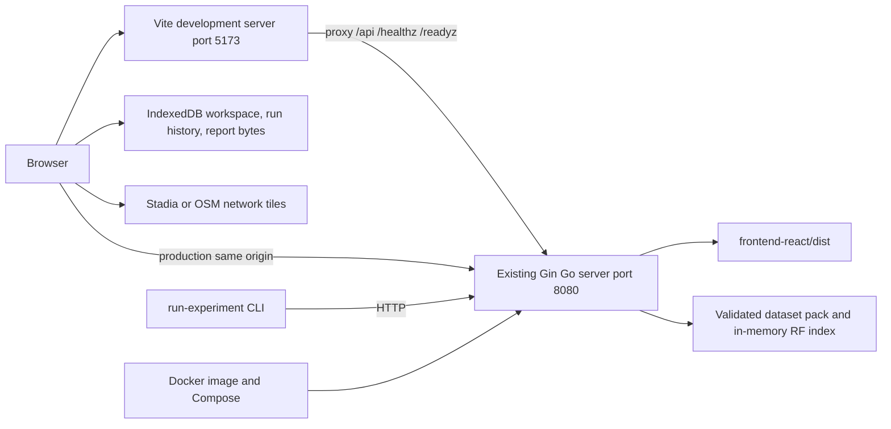
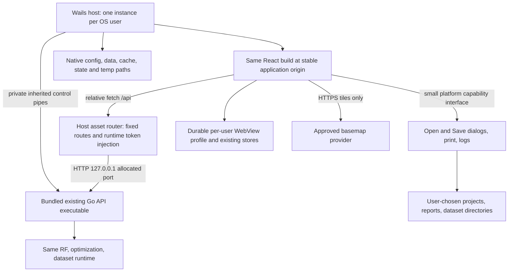
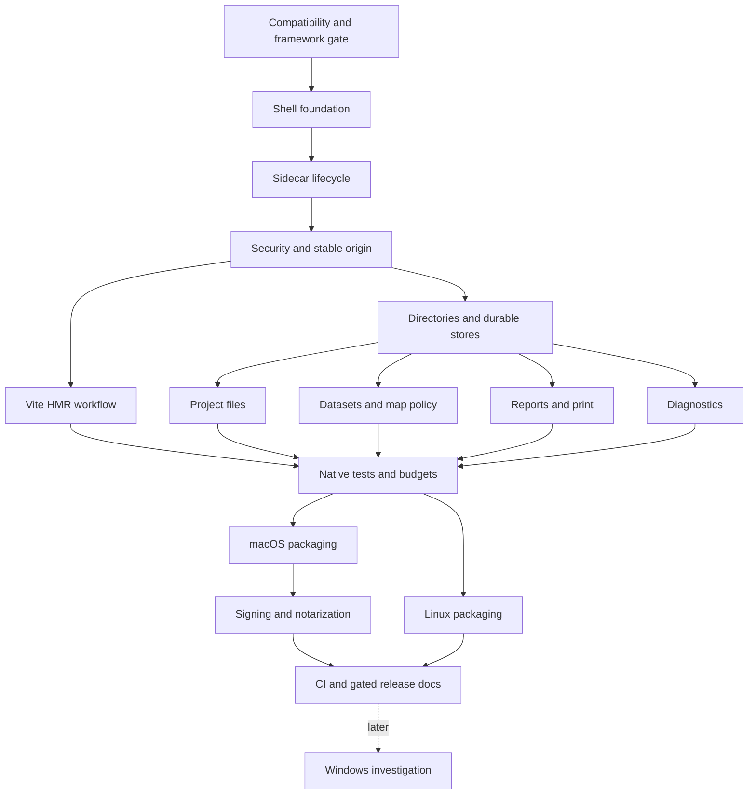

# A.T.O.M desktop architecture and implementation plan

Status: proposed architecture; implementation and release gates are **not passed**.
Audit date: 2026-10-21 (Europe/Istanbul). Scope: planning and GitHub roadmap creation only.

> **Gate 1 decision (2026-10-22): Electron is the accepted desktop shell**, with the existing React build and the existing Go API as a bundled `--desktop-control` sidecar. The maintainer accepted it after the D01 macOS spike showed that Wails v2.17.0 cannot enforce top-level navigation with supported APIs: clicking the map attribution link replaces the app. The original Wails analysis below is kept as the record of the proposal. Where it conflicts with this decision, Model C (Electron + HTTP sidecar) applies, including its sandbox/contextIsolation/IPC-validation requirements. D01 qualification ran on macOS arm64 and Intel and on Ubuntu 24.04 x86_64 under X11 and Wayland. Every check passed except one: the native file dialog on Wayland could not be automated in headless Mutter. Gate 2 awaits maintainer acceptance after a manual Wayland Save/Open check. Downstream issues (#149 onward) have not started. Evidence: [desktop-spike-design-report.md](desktop-spike-design-report.md); [#148 comment](https://github.com/Berk-Unsal/atom/issues/148#issuecomment-6334742811).

## Decision

Recommend **Model A: Wails v2 stable + the existing React/Vite application + a bundled Go HTTP sidecar**. Keep RF, optimization, HTTP contracts, project formats, and report generation shared with web/API delivery. Use native bindings only for small host capabilities: dialogs, user-approved files, lifecycle status, menus, and logs.

This recommendation is conditional on a compatibility spike, not a claim that A.T.O.M already works in WebKit. Electron with the same Go sidecar is the explicit runner-up and switch path. Do not commit the production shell until both macOS WKWebView and Linux WebKitGTK pass. Do not rewrite domain calls as Wails bindings.

The stable Wails documentation currently identifies v2.17.0; Wails states v3 is beta and v2 remains stable. Pin the actual dependency and tool versions during the spike; do not adopt v3 beta merely to work around a v2 blocker. The v2 dynamic-assets guide specifically warns about Vite 5+ in that handler path. A.T.O.M uses Vite 6.4.3, so development API routing, WebSockets, and release routing must be demonstrated separately. This warning does not establish that all Vite HMR is broken. [Wails release status](https://v3.wails.io/blog/wails-v3-beta/), [project configuration](https://v2.wails.io/docs/reference/project-config/), [dynamic-assets caveat](https://v2.wails.io/docs/guides/dynamic-assets/).

## Audited baseline and evidence boundaries

| Item | Observed value |
| --- | --- |
| Repository | `Berk-Unsal/atom` |
| Branch | `main` |
| HEAD | `b22b0937e8295d25587f7157368a70ec58a71077` |
| VERSION | `0.12.3` |
| Describe | `v0.12.3-33-gb22b093` |
| Worktree | Dirty before this task; 47 modified/untracked files, largely report redesign |
| GitHub inventory before mutations | 66 issues (9 open); 80 PRs (17 open) |

The machine-readable companion records the complete `git status --short` baseline and hashes of pre-existing changed files. No branch switch, staging, commit, PR, merge, milestone, assignment, or release is part of this task. Nothing here says a desktop build was run or measured.

Committed-source references below refer to audited HEAD. Report presentation also uses the pre-existing working-tree direction in `docs/report-guide.md`, `reportModel.js`, `reportHtml.js`, `reportMarkdown.js`, `reportMap.js`, and `reportArtifactDownload.js`; those changes are not assumed to have shipped. Revalidate integration against their eventual merged shape.

Existing open issues concern RF evidence and documentation, not a desktop host. Closed #77/#102/#106/#111/#115 and PRs #95/#121 supply portable-file, result restoration, Pareto, naming, and review-package precedent; they are references, not tickets to reopen. Open #81 remains the general report-reader guide; desktop documentation must avoid duplicating it. Open PR #63 proposes API-client HTTPS changes: any eventual desktop work must retain authenticated local HTTP as an intentional transport. Do not merge or alter that PR here. Pending React/Leaflet/Vite major upgrades (#52/#144/#146) are not desktop prerequisites; rerun compatibility evidence if they land.

## Current runtime architecture



| Concern | Current behavior and evidence |
| --- | --- |
| Development | `frontend-react/package.json`: `npm run dev` runs Vite on all interfaces; `vite.config.js` proxies to `localhost:8080`. This development exposure is not a desktop release default. `cd backend-go && go run .` starts Go. Docker Compose builds the production bundle; it does not itself provide source HMR. |
| Production UI | Root `Dockerfile` builds React then Go; Go serves `FRONTEND_DIST_PATH`, default `../frontend-react/dist`, with SPA fallback. Container path is `/app/dist`. |
| API endpoint | `src/utils/apiClient.js`: `VITE_API_BASE_URL` defaults to empty, so requests are relative. Both JSON and Blob paths need desktop transport coverage. |
| Listener | `backend-go/main.go`: `BIND_ADDRESS=127.0.0.1`, `PORT=8080` defaults. Container binds `0.0.0.0` internally, Compose publishes host loopback unless overridden. |
| Readiness | `/healthz`, `/readyz`, `/api/meta`; current `/readyz` requires buildings, towers, and an on-disk frontend `index.html`. Vite-only development cannot blindly use this combined check. |
| Configuration | Environment-based RF limits/keys/deadlines, `FRONTEND_DIST_PATH`, `ATOM_DATASET_DIR`, `ATOM_DATASETS_ROOT`, dataset administration key, proxies, HTTPS, and optional Core Lab settings. Desktop must construct an explicit configuration instead of inheriting arbitrary web deployment values. |
| Dataset | `dataset_runtime.go`: manifest discovery uses working-directory/container fallbacks unless configured. Installed packs are enumerated beneath one root; switching validates a complete pack before changing the active in-memory pointer. No native arbitrary-folder registry exists. |
| Integrity | `raytracer/dataset_pack.go`: manifest/schema/path checks and mandatory SHA-256 checks for declared layers. Reuse these validators, including symlink containment. Hash identity does not establish source trust or scientific accuracy. |
| Persistence | `projectStore.js`: workspace IndexedDB `atom-planning-workspace`, localStorage fallback; workspace schema 2, portable file schema 3, imports support 1/2/3, 16 MiB portable-file cap plus structural/expanded guards. `runHistoryRepository.js` and `artifactStore.js` have separate IndexedDB stores. Go is not the project database. |
| Project I/O | Portable `.atom-project.json` export/import uses the existing serializer/parser. Import validates before replacing the active context. Browser export downloads bytes. Files do not automatically include every separately stored run/artifact byte. |
| Reports | Shared frontend report generation, retained artifact bytes/hashes, browser Blob downloads, popup HTML printing, and local review ZIP creation. There is no Go PDF service to reuse. Redesign uses one report presentation model for Markdown/HTML, schematic SVG map, full provenance, and Chromium-reference print CSS. |
| Assets/network | React, Leaflet, icons and system fonts are local; tile URLs are external. Documentation/source links open external sites. Optional Core Lab is a separate network service and remains optional. |
| Shutdown/headless | `server_lifecycle.go` listens directly and drains HTTP on interrupt/SIGTERM with a 30-second timeout. Shell parent-death control, endpoint announcement, and crash recovery are absent. `cmd/run-experiment` is an HTTP client; dataset validator/import CLI paths remain independent. |

## Architecture options for A.T.O.M

| Criterion | A: Wails + HTTP sidecar | B: Wails + direct domain bindings | C: Electron + HTTP sidecar |
| --- | --- | --- | --- |
| Reuse/divergence | Same React, API and Go executable; small host adapter | Go math reused but request, error, auth, cancellation and workflow transport split | Same React/API/Go executable; JS host plus constrained preload |
| Go integration | Go host supervises Go binary; no domain extraction required | Requires extracting package-main routes/workflows into importable services | Child binary supervision from main process; no RF extraction |
| React/Vite/HMR | Existing sibling frontend; native engine and Vite routing must pass spike | Same HMR opportunity, plus binding generation/rebuild coordination | Vite dev URL and Chromium familiar; main/preload restart separately |
| Engine/map | WKWebView, WebKitGTK, later WebView2; real Leaflet/canvas/SVG/keyboard evidence required | Same engine risk as A | Chromium bundled everywhere; closer to existing Playwright baseline, still requires native smoke tests |
| Printing/PDF | Existing HTML must work through an isolated native print surface; no assumed Wails PDF API | Same print risk as A | `webContents.printToPDF` offers a direct PDF path from shared HTML |
| Security | Authenticated loopback + stable asset origin + narrow native capabilities | Fewer sockets only if HTTP removed, but privileged binding surface grows | Same authenticated sidecar plus sandbox, context isolation, disabled renderer Node, and strict IPC validation |
| Size/memory | Likely lower shell overhead because OS engine is reused; full dataset/index dominates and must be measured | No meaningful RF advantage | Bundled Chromium/Node and renderer processes add overhead; measure rather than quote generic numbers |
| Packaging/portability | Native build tools; Linux GTK/WebKit ABI and runtime packages need an explicit baseline | Same, plus deeper Go application coupling | Mature packaging ecosystem; still native libraries, signing, sidecar inclusion and supported distro work |
| Test/CI | Browser tests retained; native WebView coverage is additional and harder to automate | Extra transport parity testing needed | Playwright has experimental Electron automation; native dialogs/lifecycle still need OS tests |
| Maintenance | Small Go host, system engine updates, scoped OS integration | Two domain interfaces and greater product drift | Additional JS main/preload dependencies and regular Chromium/Electron security upgrades |

Recommendation: A if the spike passes; runner-up C if it does not. Reject B for MVP because avoiding loopback does not justify duplicating the application boundary. Tauri is not a stronger candidate here: it adds Rust while retaining system-WebView compatibility work and the Go sidecar. A native UI rewrite, remote hosted shell, and a bundled second Chromium solely to rescue Wails printing are rejected.

These are project-specific engineering judgments, not measured framework rankings. Relevant upstream references: [Wails architecture/features](https://v2.wails.io/docs/introduction/), [Electron process model](https://www.electronjs.org/docs/latest/tutorial/process-model), [PDF API](https://raw.githubusercontent.com/electron/electron/main/docs/api/web-contents.md), [Electron testing](https://www.electronjs.org/docs/latest/tutorial/automated-testing), [Tauri architecture](https://v2.tauri.app/concept/architecture/).

## Proposed runtime, process and port model



The WebView does **not** navigate to a new random-port origin every launch. Use a framework-owned stable origin and explicitly configured durable profile. Route `/api`, `/healthz`, `/readyz` and narrowly defined desktop status through an allowlisted host router to the sidecar. React continues to make HTTP-shaped fetch requests and the sidecar receives the existing HTTP API. The renderer need not learn the port or possess its credential. The host learns the actual address over its private control channel and atomically updates one routing target on restart. Do not use `file://`, a public endpoint-discovery file, or a build-time VITE URL for the runtime endpoint.

Wails documents asset middleware that can route requests, but its Vite caveat makes this a proof obligation. In development, use explicit Vite `/api` proxying with a host-owned target and server-only credentials; prove the stable origin, WebSocket HMR and native bridge work together. If this requires an unsafe origin, broad CORS, Vite downgrade, framework fork, or duplicating fetch implementations, use Electron with a stable registered application protocol and the same HTTP sidecar instead. [Asset middleware](https://v2.wails.io/docs/reference/options/).

Startup state machine: `starting → listening → dataset-ready → UI-ready`, or an actionable failure state. Resolve absolute bundle/resource paths and writable directories first. Acquire a per-user instance lock before starting the child. Spawn only the bundled executable from a verified bundle path, with a curated environment and argument array. The child itself binds `127.0.0.1:0` once, retains that listener, then announces its actual address, protocol version, PID, product version/commit and readiness on a private inherited pipe. Do not reserve a free port, close it, and later rebind it.

Use `/api/meta` and dataset/control readiness to verify the expected process and model/pack identity. A timeout produces retry/open-logs/quit actions without pretending the dataset is ready. Preserve public `/readyz` semantics for browser/Docker users; add a private desktop component-readiness contract so Vite development is possible without a stale `dist/index.html`. Release UI assets still undergo their own integrity/presence check.

The host monitors child exit and control-channel EOF. A child crash disables new RF actions, aborts in-flight fetches, marks affected results/runs interrupted or stale through existing semantics, and offers an explicit restart. No automatic RF replay. A development rebuild may restart once automatically after a successful compilation, while failed builds leave the last good process usable and show a diagnostic. Rotate credentials and runtime generation on every restart; responses from older generations cannot overwrite newer workspace state.

Closing the only window quits the application for MVP, including macOS; do not leave a hidden backend. Flush outstanding store writes, apply a dirty-file prompt where appropriate, stop admission, cancel host-owned jobs/request contexts, then request child shutdown. Allow a bounded drain (reuse existing 30-second ceiling; show progress for long work), terminate only this child if it fails to exit, and reap it. The child watches private parent-channel EOF so a crashed host cannot leave an orphan listener. On Linux/macOS use platform-appropriate process handling; keep shutdown control portable for Windows later. A second launch focuses the existing window and exits without spawning another child or sharing write ownership; dev/test profiles are isolated. Never kill by process name or a stale PID file.

## Desktop security model

Assume untrusted webpages, imported project/report strings, dataset paths, external links, and another local OS user. The host is trusted within the logged-in user's privilege boundary; same-user malware and OS compromise are outside the MVP guarantee.

| Surface | Planned control and observable check |
| --- | --- |
| Loopback API | Explicit IPv4 loopback listener, random 256-bit credential per child generation, auth on all desktop-mode API/metadata/status routes; unauthenticated calls fail. Preserve existing RF/building/admin semantics beneath desktop transport auth. No LAN listener. |
| Credential delivery | Host-only inherited private pipe, never command line, URL/query, browser storage, log, `VITE_*`, or shared temp file. The allowlisted proxy injects it; reject arbitrary proxy destinations/redirects. |
| Host/origin/CSRF | Validate exact listener Host/port and expected Origin where present. A host-injected request still requires the secret when Origin is absent; CORS is not authentication. No wildcard origins, cookies, or broad localhost allowlist. Reject DNS-rebinding/foreign-origin and wrong-generation tests. |
| WebView authority | Lock top-level navigation and new-window requests to the application; deny untrusted frames, file navigation and drag navigation. Open explicitly allowed HTTPS documentation/attribution URLs in the OS browser after scheme validation. Scripted navigation and redirects must be tested at the engine boundary; click interception alone is insufficient. Unsupported enforcement is a framework switch condition. |
| CSP | Apply CSP to the Wails-served shell; current Go CSP does not automatically protect host-served HTML. Keep production scripts local, connect only to the internal API route, and allow only approved HTTPS tile image origins. Add dev-only HMR WebSocket allowances on loopback, never to release policy. Account for Leaflet inline styles and reviewed Wails runtime injection without broad unsafe script exceptions. |
| Native filesystem | Typed Open/Save/SelectPack capabilities return operation-scoped handles. No generic arbitrary read/write/exec/URL-fetch binding. The host owns dialog-selected paths; enforce size caps, extensions and safe overwrite/atomic-write behavior. Validate resolved paths/symlinks, reject unexpected traversal and recheck before writes. |
| Project/report inputs | Reuse current bounded parser and escaping; treat imported/stored HTML as untrusted. Report preview/print has no native bridge and no network by default. Do not expose privileged main WebView to a retained HTML artifact. |
| Dataset paths | Reuse complete manifest/layer hash validation and containment; no root switch from an untrusted renderer-supplied path. Directory selection permits only that pack. No new ZIP extraction in MVP. |
| Other OS users | Private directories/locks/control objects, directories 0700 and private files 0600 on Unix; token protects the TCP port across users. Diagnostics redact secrets and user paths. No claim to defend against the same user reading their own process memory. |

This is one random local credential and a narrow capability adapter, not a new account system or PKI. If Electron is selected, additionally set renderer sandbox/contextIsolation on, nodeIntegration off, validate every IPC sender/argument, and deny arbitrary navigation/permissions. [Electron security guidance](https://www.electronjs.org/docs/latest/tutorial/security).

## Filesystem and durable data

| Kind | macOS | Linux | Windows later |
| --- | --- | --- | --- |
| Durable data / installed packs / profile | `~/Library/Application Support/A.T.O.M/` | `${XDG_DATA_HOME:-~/.local/share}/atom/` | Per-user LocalAppData `A.T.O.M/` |
| Settings / dataset registry | Application Support `A.T.O.M/config/` | `${XDG_CONFIG_HOME:-~/.config}/atom/` | Explicit per-user config path; decide roaming-only settings separately |
| Cache | `~/Library/Caches/A.T.O.M/` | `${XDG_CACHE_HOME:-~/.cache}/atom/` | LocalAppData cache |
| Logs / recent-file state | `~/Library/Logs/A.T.O.M/` and Application Support state | `${XDG_STATE_HOME:-~/.local/state}/atom/` | LocalAppData logs/state |
| Control/temp objects | Private OS temp subdirectory | Valid private `XDG_RUNTIME_DIR/atom/`, otherwise private OS temp | User temp / named pipes with per-user access control |
| User documents | Explicitly selected Open/Save destinations | Explicitly selected Open/Save destinations | Explicitly selected Open/Save destinations |

Paths above are design intent, not literal tilde-containing runtime strings. Resolve native paths with OS helpers, reject relative XDG overrides, handle missing/unwritable locations visibly, and preserve private permissions. Never write into the installed bundle, cwd, `/app`, or repository. Bundle resources are read-only. Use separate dev/test profiles, never reset the release profile on upgrade, and prove IndexedDB workspace/run/artifact persistence across port changes, relaunch, executable relocation and an app upgrade. Do not move browser data silently; users migrate with portable import/export. Native profile placement and stable origin must be confirmed on both Wails engines; if they cannot be made durable without maintaining a framework fork, switch shells. [XDG specification](https://specifications.freedesktop.org/basedir/latest/).

Projects and reports stay in user-selected directories; private autosave/recovery is not a substitute for saving a portable file. Do not replace all current stores with SQLite or a second Go persistence layer in MVP.

### Project file experience

File → Open validates a selected `.atom-project.json` through the existing parser before activating it; cancellation/rejection leaves the workspace and evidence intact. File → Save serializes the active project's current portable representation to its associated path; first Save asks for a path. Save As writes to a new selected path and changes that association only after success. Export Project writes a portable copy without changing the association. Save is a filesystem operation; **Save Version remains the existing planning-history operation** and creates no hidden RF work.

Retain schema 3, schema 1/2 import compatibility, 16 MiB/expanded/structural bounds and existing result-lineage limits. Exceeding a limit must not silently truncate evidence or overwrite the last good file. Use same-directory temporary files, flush and atomic replacement, detect externally modified files, and report permission/full-disk/conflict failures. Maintain a separate unsaved-to-file indicator and prompt before losing file edits; browser-local autosave status alone cannot mean the file is saved. The current portable format does not promise all independent run-history/artifact bytes; review packages and reports remain complementary evidence, not a new editable format. File associations and alternate extensions are deferred.

### Dataset experience

Data → Add Dataset Pack selects a directory or its `manifest.json`, validates it with `LoadDatasetPack`, shows ID/version/size/source/license/hash details and offers **Copy into app storage** (default) or **Reference this directory** (advanced, useful for large packs). MVP accepts the existing directory pack format, not an invented archive or arbitrary-city ingestion flow.

Copies stage into a private temporary directory under the managed data root, check free space, copy only declared safe pack files, validate the staged complete pack again and rename/register atomically. Cancellation, full disk or bad hashes leaves the active pack untouched. Deduplicate by identity/version/content hashes and reject ambiguous same-ID content. Reference entries use a small native registry of user-approved absolute roots; extend runtime candidate discovery narrowly rather than creating symlink farms or weakening root containment. Reference content is revalidated on load/activation; moved/unmounted/changed directories get a locate/remove recovery action and no silent dataset substitution. Dataset references in portable projects remain IDs/versions/hashes, not machine paths.

Keep the existing validated switch and stale-result handling. Persist the selected pack for relaunch; serialize activation versus in-flight RF according to existing runtime guarantees. Do not delete referenced packs on uninstall or mutate them in place.

The default Ankara building file is about 111 MiB on disk. Its manifest explicitly says to review upstream OpenCellID terms before redistribution. Public distribution is blocked until a maintainer records an appropriate redistribution basis, attribution and pack provenance, **or** selects an already-supported redistributable default/sample pack. No scientific regeneration or weaker hash rules are authorized here. The clean-machine planning flow must work with that bundled approved pack before an optional download; it must not require Docker mounts, terminals, or an unannounced first-run network fetch.

### Reports, review packages and printing

Wrap existing byte outputs with OS Save dialogs for Export Report, Export Project and Export Review Package. Keep `buildPlanningReport`, historical source resolution, shared presentation/renderers, `buildReportArtifactOutput`, retained-byte hashes and `buildReviewPackage` semantics. Native writing is a destination adapter, not a second report generator. Downloading an existing artifact must preserve its exact bytes, name and hash; explicit regeneration remains a separate action with current generator metadata. Do not run RF on export or silently rebuild missing evidence.

Export Markdown, self-contained HTML, SVG where offered, and the existing review ZIP directly. Print/PDF consumes the same shared HTML through a restricted native print surface, with no filesystem capability or main-window bridge. Test A4 portrait, CSS margins, selectable text, long Cell IDs, Turkish characters, diagrams, light/dark appearance, source lineage and pagination against the current Chromium reference. Page count may vary by engine; missing quantities, clipped evidence, substituted source values or unreadable pagination cannot pass. Native print/PDF must work on both targets without a new report model, framework fork, required external Chromium install or bundled second browser. If that cannot be achieved, choose Electron's shared-HTML `printToPDF` route. Do not claim Wails has an equivalent ready-made PDF API.

## Map and network dependency assessment

| Capability | Classification |
| --- | --- |
| Local RF / network evaluation / optimization with installed valid pack | Offline-capable; preserve existing 4G/5G/6G availability and 8-Cell limits |
| Project/history/artifact reading and native project/report exports | Offline-capable subject to retained data and filesystem access |
| Schematic SVG report map / bundled app code / system fonts | Offline-capable; no base-tile download required |
| Stadia Alidade light/dark tiles | Network; the current localhost development exemption is not a desktop production entitlement |
| OSM Standard tiles | Network; identify the application and retain attribution/cache behavior under provider policy |
| Documentation/source links and optional Core Lab | Network/external service; core planning must not depend on their availability |
| Tile cache | Only normal provider-permitted HTTP caching; offline-area distribution is out of MVP |

Stadia explicitly recommends API keys for desktop applications. Do not ship a private shared provider key in the renderer or assume a `wails.localhost` origin is authorized. The map integration issue must settle a production provider configuration: an approved distributable desktop credential arrangement or a policy-compliant OSM fallback selected visibly for desktop. Any user key is an explicit setting and redacted from logs. Test the actual native origins and user-agent/referrer behavior; do not spoof development access. [Stadia authentication](https://docs.stadiamaps.com/authentication/). OSM's tile service prohibits bulk/offline prefetch and expects compliant caching and identification; an AppImage does not change those terms. [OSM tile policy](https://operations.osmfoundation.org/policies/tiles/).

Missing tiles must keep RF overlays, selection, error messaging and reports usable. Desktop does not promise fully offline street basemaps.

## Development and repository workflow

No root Makefile exists. Keep current commands; add focused shell wrappers under the established `scripts/` directory in implementation rather than introducing a second frontend or mandatory packaging loop.

| Mode | Commands (desktop commands are proposed, not implemented) | Behavior |
| --- | --- | --- |
| Web dev | `cd backend-go && go run .`; separately `cd frontend-react && npm run dev` | Existing browser + Vite proxy/HMR, no desktop toolchain required |
| Docker/browser | `docker compose up --build -d atom` | Existing packaged local web application at `http://localhost:8080`; retains current container tests/release |
| Desktop dev | `./scripts/desktop-dev.sh` | Start supervised development sidecar and existing Vite, run Wails dev with sibling frontend configuration; bind dev services to loopback; no installer build |
| Desktop release build | `./scripts/desktop-build.sh` | Build existing React dist and native Go sidecar, assemble local native bundle; explicit package/sign modes for CI/public artifacts |
| Desktop test | `./scripts/desktop-test.sh` | Host/control tests + small actual-engine/native smoke suite, no signing needed |

Frontend JSX/CSS: Vite HMR updates the native WebView, preserving ordinary React HMR behavior. Target edit-to-visible p95 ≤1 second over 20 warmed edits on the reference machine. No Go rebuild or packaging. Backend Go: watch `backend-go` and `raytracer`, debounce, compile a new child first, then cancel/drain and replace it; publish a new runtime generation through the stable host route. Target warm rebuild/reconnect ≤5 seconds for a representative small edit, measured rather than guaranteed. A failed build leaves the last good process available. Shell Go: Wails rebuild/relaunch, restore committed profile state, and ensure old child reaping; target ≤10 seconds warm. First toolchain setup/build is measured separately. No DMG/AppImage/deb is needed for these edit loops.

```text
frontend-react/                 same React application, domain/repository/report helpers
  src/platform/                proposed small browser/native capability adapter
backend-go/                    same API entry point, runtime and RF packages
desktop/                       proposed independent host module; no product math
  internal/                    supervision, proxy/security, dirs/dialogs/logging
  build/                       icons, manifests, platform packaging metadata
  wails.json                   points frontend:dir to ../frontend-react
scripts/desktop-*.sh            proposed dev/build/test orchestration
docs/desktop-architecture-design-plan.md
docs/desktop-roadmap-design.json
```

Go module separation keeps GTK/CGO shell dependencies out of headless/Docker builds. Sidecar reuse avoids importing package `main`; only extract startup/configuration/control helpers if implementation proves necessary, keeping the current web entry point and tests. Stage build assets beneath the shell build directory when Go embedding requires paths inside the module; do not copy source/screens or commit a second dist tree. API types, RF/optimizer logic, report model and persistence schema have one owner. No UI panels are added merely to explain runtime details.

The companion JSON is under `docs/` because `planning/*` is ignored except an existing allowlist. Both new filenames include `design`, so the existing documentation classifier recognizes them as internal plans. Add only these entries to the source catalog; leave pre-existing report-catalog drift visible. The plan is source documentation, not a new published reference page; do not regenerate unrelated HTML/search files.

## Compatibility spike and objective exit criteria

First implementation task: run a disposable, maintainable proof of concept using the current frontend and real Go backend on macOS WKWebView and Ubuntu 24.04 WebKitGTK 4.1, alongside a fixed Chromium baseline. Record hardware, OS, shell/toolchain/engine versions, pack hashes, commit, mode and timings. Native runs are required; Playwright WebKit is a useful early warning but is not WKWebView/WebKitGTK certification.

Test both dev and release-like assets: launch/readiness, Leaflet tiles and offline tile failure, markers/rays/polygons, canvas/SVG, light/dark, Results and Pareto visualization, all tool drawers, keyboard/focus, 8-Cell evaluation and optimization, 4G/5G/6G availability, JSON/Blob requests and cancellation, project persistence across a port change/relaunch, report HTML/PDF, native Open/Save, navigation/bridge isolation and clean child exit. Test long paths and Turkish characters. Include native print API feasibility and enforceable top-level navigation policy in the spike, not after shell lock-in.

| Result | Objective decision |
| --- | --- |
| Wails PASS | All critical workflows pass on both OS targets in dev and release-like mode; correct numerical/source outcomes; durable stores after relaunch/port change; HMR p95 ≤1s; no auth/navigation/print/data-integrity failure; supported APIs and no product fork. |
| ACCEPTABLE WITH FIXES | All critical data/security/runtime/print checks pass; at most three bounded presentation/accessibility defects with an estimated total ≤3 engineer-days, named owners by role, regression scope and no RF/schema change. Close those fixes and rerun before accepting Gate 2. No contributor assignment is implied. |
| SWITCH TO ELECTRON | Any unresolved critical workflow, unsafe navigation/bridge exposure, storage loss, blocked report/PDF path, Vite downgrade/fork requirement, HMR >2s after one bounded routing investigation, or unsupported Linux runtime dependence. One OS failure is sufficient; do not maintain different shells per OS. |

No calendar deadline is assigned. A bounded investigation is an effort cap to avoid endless framework repair, not permission to waive a gate. Update the ADR and the same roadmap if the shell switches; retain HTTP/data/project/report contracts.

## Tests, performance and diagnostics

Preserve Vitest, Go `vet`/race suites and current Chromium Playwright workflows at all four viewports. Add small WebKit browser coverage for early feedback and a thin native layer for actual engines and OS actions. Wails does not provide Chromium's Playwright attachment as an assumed testing interface. The spike must select a supportable native automation/OS-accessibility strategy; dev-only probes must be absent from release. Deterministic host/control tests use injected listeners/processes/dialog adapters, while at least one native Open/Save/Print path per OS is exercised for real.

Desktop smoke matrix: launch, real child readiness, UI connection/map, Run Sector, network evaluate/optimize, portable Open/Save/Save As and rejected/cancelled I/O, dataset add/switch/failure recovery, report/review export and printing, second launch, child crash/restart, quit and forced parent death with no remaining listener. Keep slow real-engine cases few; do not port every frontend test into desktop automation. Compare deterministic RF results for identical requests/pack hashes, allowing documented metadata/timing differences only.

Initial engineering budgets, all **unmeasured**: on a recorded four-core/16-GiB SSD reference machine with the default approved pack, launch-to-plannable p95 ≤10s cold / ≤5s warm; child+dataset-ready p95 ≤8s cold / ≤4s warm; aggregate host/WebView/helper/Go idle resident memory ≤500 MiB after 60s idle; Wails compressed app+default-pack ≤250 MiB per architecture; sustained map interaction ≥30 FPS and p95 interaction response ≤100ms at 1440×900 using the representative 8-Cell fixture. Report framework overhead separately from dataset bytes/index memory. RF/optimization medians should stay within 5% of the same standalone binary after warmup, with identical deterministic outputs. Use 20 samples for startup and warmed RF comparisons and retain raw measurements. Linux records PSS as well as RSS; macOS uses comparable process-tree accounting. Exceptions require evidence and a written budget revision; these are not marketing claims or reasons to alter RF caps.

Capture structured host/backend logs with timestamp, level, component, product/build and runtime generation, readiness stages and redacted error classes. Proposed rotation: 5 MiB per file, five retained files per component. Release uses info/warn/error; dev may enable debug. Never log credentials, raw project/report bodies or RF request content by default; redact user paths and tile keys. Help → Open Logs opens the native log folder. Startup failures must still have a minimal log if configured paths fail; show a clear error and safe temporary fallback location. A minimal stderr capture belongs to the first lifecycle implementation; the later diagnostics issue adds rotation, UI and support metadata. No automatic telemetry, crash upload or unsolicited diagnostics transmission.

## Native UX and distribution

MVP has one normal resizable window, bounded remembered geometry, app icon/title/About/version, Quit, File Open/Save/Save As/Export and standard platform accelerators. Route keyboard/menu operations through the same capabilities as the existing UI. Use explicit unsaved-file prompts; preserve current Save Version naming. Native dialogs use cancellation as a normal outcome. External links open safely in the system browser. No tray, agent, global shortcuts, elaborate multi-window, or global file association is needed.

| Surface | Initial strategy and gate |
| --- | --- |
| macOS | Proposed support floor macOS 14+, Apple Silicon and Intel x86_64 as separate architecture artifacts. Native qualification is required for both; no Intel-support claim from cross-compilation alone. Build `.app` containing host, executable sidecar and approved read-only default resources; DMG for public download, zipped app acceptable for internal CI. Universal packaging is deferred to avoid merge/sign complexity. Reconfirm the OS floor and toolchain availability in the spike; if Intel qualification cannot be supported, narrow the declared support before release instead of silently omitting it. |
| Signing/notarization | Local dev needs no Developer ID; ad-hoc signing may be used by build tools. Internal unsigned/ad-hoc CI artifacts are explicitly untrusted development artifacts. Public macOS release requires Developer ID Application signing of nested sidecar/helpers before the app, hardened runtime with minimal reviewed entitlements, `notarytool` submission, ticket stapling and `codesign`/`spctl` clean-machine checks including quarantine and offline launch of the stapled build. Credentials live in protected release CI, never PR jobs. No bypass-Gatekeeper instructions as the normal install flow. |
| Linux | Initial supported environment: Ubuntu 24.04 LTS x86_64 GNOME, current vendor updates, X11 and Wayland sessions. Produce `.deb` first with declared GTK3/WebKit2GTK 4.1 and actual inspected native runtime dependencies; build Wails v2 with `webkit2_41` as documented. Include icons, `.desktop` launcher, executable sidecar permissions and app metadata. Installation through a graphical package manager must resolve runtime libraries without Node/Go/Docker. Test on fresh images, not just the build machine. Other distros/ARM64 are unqualified until added explicitly. |
| AppImage evaluation | Optional distribution experiment after the `.deb`: prove WebKitGTK subprocess/resources, native library/GLIBC compatibility, sandbox behavior, licensing and launch without a development toolchain or FUSE-terminal workaround. Do not call AppImage universally portable or block the first supported `.deb` release on it. Flatpak is a later candidate if dependency isolation warrants portal/sandbox work; RPM is out of initial scope. |
| Windows later | Keep portable control pipes, path abstractions, argument arrays, atomic-save behavior and case/Unicode-aware tests. A deferred issue covers WebView2 provisioning (or Chromium if Electron chosen), installer, signing, per-user AppData, reserved/long paths, process lifetime, dialogs and native smoke coverage. Not a macOS/Linux release prerequisite. |
| Release identity | All delivery targets use root VERSION and existing model semantics. Desktop embeds that version + commit + shell/engine/OS/arch/build-mode metadata; no second desktop SemVer, tag stream or model version. Add desktop artifacts/checksums/SBOM/licenses to the existing release flow only after gates pass; preserve container and API/CLI delivery. |
| Updates/associations | Manual download/install and safe profile-preserving upgrades for MVP; no updater service. Future signed updates require provenance, rollback, migrations and platform policy review. File associations may later register existing `.atom-project.json` behavior (including compound-extension limitations), never a new incompatible format. Deferred notes live in the tracker; they do not create more MVP tickets. |

[Wails Linux build dependency guidance](https://v2.wails.io/docs/gettingstarted/installation/), [Wails native dialog API](https://v2.wails.io/docs/reference/runtime/dialog/), [Apple signing/notarization model](https://support.apple.com/en-ie/guide/security/sec3ad8e6e53/web), [Apple notarization workflow](https://help.apple.com/xcode/mac/current/en.lproj/dev88332a81e.html).

## MVP, non-goals and decision gates

A clean supported machine installs/opens the app, loads approved bundled/default planning data, sees the current UI/map, runs Sector and 8-Cell network evaluation/optimization under the same availability limits, retains workspace/history correctly, opens/saves a portable project, adds a pack using dialogs, exports a readable report/review package, finds logs, and quits without an orphan backend. The normal user installs no Docker, Git, Go, Node or terminal tools. Network is still required for online basemaps. Developer JSX/CSS changes remain immediate, Go rebuilds are bounded, browser/Docker delivery stays supported and existing tests remain useful.

Out of MVP: Windows, auto-updater, offline basemap distribution, cloud sync/accounts, native UI rewrite, RF/model/product changes, new project formats, plugins, tray/menu agent, global shortcuts, multi-window architecture, arbitrary-city data ingestion, universal macOS binary, universal-Linux claim and file associations. There are no release dates or assigned contributors.

| Gate | Evidence needed | Current state |
| --- | --- | --- |
| 1 Framework | Maintainer records Wails recommendation or evidence-based Electron switch, exact major/toolchain and support floor | Recommendation recorded; final acceptance pending spike |
| 2 WebView compatibility | Both native engines pass the spike matrix, print/security/stable-store/HMR included; bounded defects closed | Not run |
| 3 Runtime | Dynamic listener, expected-version handshake, readiness, crashes/restarts, parent death, instance lock and clean stop demonstrated | Not implemented |
| 4 Developer experience | Measured HMR/backend/shell loops meet targets without packaging; clean web/Docker paths still pass | Not implemented |
| 5 Filesystem | Native projects, durable stores, complete pack integrity, exports/print and recovery work without Docker paths | Not implemented |
| 6 Distribution | Clean supported macOS/Linux machines launch actual packaged artifacts, approved default data present, macOS signing/notarization verified | Not implemented |

Public desktop release requires all six gates; an issue checklist alone is not release evidence. Dataset redistribution basis, production tile access and secure native navigation are explicit blocking questions, not implied approvals.

## Dependency-aware implementation roadmap

There are 16 child issues: 15 active implementation packages and one deferred Windows investigation, plus one tracking issue. Each includes Context, Problem, Scope, Acceptance criteria, Non-goals, Evidence / references, Dependencies and Contributor notes. Machine data contains labels, effort/risk, hard prerequisite IDs, final GitHub links and verification records. Dependencies are issue-body links; no milestones or dates are created.

| ID | Group | Priority | Scope | Hard prerequisites |
| --- | --- | --- | --- | --- |
| D01 | FOUNDATION | P1 | Native WebView/framework compatibility spike and ADR acceptance | None |
| D02 | FOUNDATION | P2 | Thin shell, platform adapter, minimal window/menu UX | D01 |
| D03 | FOUNDATION | P1 | Bundled Go sidecar supervision and dynamic listener | D02 |
| D04 | FOUNDATION | P1 | Stable origin routing, runtime auth and capability security | D03 |
| D05 | FOUNDATION | P2 | Existing Vite HMR and safe backend/shell rebuild workflow | D04 |
| D06 | MVP | P2 | Native directories, persistent WebView profile and recovery | D04 |
| D07 | MVP | P2 | Native project Open/Save/Save As/Export | D06 |
| D08 | MVP | P1 | Dataset install/reference integrity and production basemap/default-data policy | D06 |
| D09 | MVP | P2 | Shared report/review export and isolated native print/PDF | D06 |
| D10 | MVP | P2 | Bounded logs, diagnostics and actionable runtime failures | D06 |
| D11 | MVP | P2 | Additive native smoke, deterministic parity and performance budgets | D05,D07,D08,D09,D10 |
| D12 | DISTRIBUTION | P2 | macOS architecture packages and bundle metadata | D11 |
| D13 | DISTRIBUTION | P1 | macOS signing, notarization and clean-machine validation | D12 |
| D14 | DISTRIBUTION | P1 | Supported Ubuntu .deb and native runtime qualification | D11 |
| D15 | DISTRIBUTION | P2 | Desktop CI artifacts, unified gated releases and install/contributor documentation | D13,D14 |
| D16 | LATER | P3 | Deferred Windows runtime/installer/compatibility investigation | D15; deferred, never blocks MVP |



Hard dependencies describe completion order. D05/D06 proceed in parallel after D04; D07–D10 proceed independently after D06; macOS/Linux distribution branches run in parallel after D11. Packaging feasibility is probed in D01 and metadata drafts can be prepared early; do not wait until the end to discover a framework blocker. Minimal crash logs and testable interfaces belong to foundation work, even though diagnostics/test completion has later issues.

Priority allocation excludes the tracker: P1 six, P2 nine, P3 one. The tracker itself is P2. Maintainer-owned: D01–D09, D13, D15 and D16; D10–D12/D14 are contributor-friendly after their contracts are stable and carry `help wanted`. No whole issue is sufficiently small/safe for `good first issue`. Packaging icon/docs subtasks may become suitable later without creating extra tickets now. Reuse existing type/priority/area labels; create only `area: desktop`.

## Risks, open questions and verdict

Highest risks: native WebKit behavior differs from Chromium; Wails asset routing and current Vite may interact badly; current report print CSS is Chromium-referenced; durable profile placement and navigation controls need actual native verification; Linux WebKitGTK packaging depends on a declared distro; default-data redistribution and production tile access are unresolved; child process failure must not replay RF or corrupt retained history. Signing credentials and Intel test capacity are external prerequisites for claims about public artifacts.

The spike must answer: what stable origin/profile path is used on each OS; can Wails v2 enforce navigation and isolate report printing with supported APIs; can the current Vite major retain HMR and proxy cancellation; what native automation approach is supportable; what are the measured startup/memory/package costs; and can the proposed macOS floor/Intel matrix be qualified? Data/provider decisions belong to D08 and must be settled before distribution. Keep these unresolved until evidence exists.

Final recommendation: one React frontend, one Go product/API implementation, thin Wails delivery host with authenticated loopback sidecar and narrow native file capabilities, gated by a real two-platform spike. Electron is a prepared fallback, not a second maintained product. The roadmap is ready for implementation intake; **desktop implementation has not started and the product is not release-qualified**.

## Materialized GitHub roadmap

Tracking issue: [#147 — Desktop application roadmap: macOS and Linux](https://github.com/Berk-Unsal/atom/issues/147).

| ID | GitHub issue | Group | Priority | Depends on |
| --- | --- | --- | --- | --- |
| D01 | [#148 — Desktop: validate Wails WebView compatibility and finalize the shell decision](https://github.com/Berk-Unsal/atom/issues/148) | FOUNDATION | P1 | None |
| D02 | [#149 — Desktop: establish the thin shell and shared platform capability adapter](https://github.com/Berk-Unsal/atom/issues/149) | FOUNDATION | P2 | [#148](https://github.com/Berk-Unsal/atom/issues/148) |
| D03 | [#150 — Desktop: supervise the bundled Go backend on a dynamic loopback endpoint](https://github.com/Berk-Unsal/atom/issues/150) | FOUNDATION | P1 | [#149](https://github.com/Berk-Unsal/atom/issues/149) |
| D04 | [#151 — Desktop: secure stable-origin API routing and native capabilities](https://github.com/Berk-Unsal/atom/issues/151) | FOUNDATION | P1 | [#150](https://github.com/Berk-Unsal/atom/issues/150) |
| D05 | [#152 — Desktop: preserve Vite HMR and safe Go rebuilds in the development loop](https://github.com/Berk-Unsal/atom/issues/152) | FOUNDATION | P2 | [#151](https://github.com/Berk-Unsal/atom/issues/151) |
| D06 | [#153 — Desktop: use native data directories and durable WebView storage](https://github.com/Berk-Unsal/atom/issues/153) | MVP | P2 | [#151](https://github.com/Berk-Unsal/atom/issues/151) |
| D07 | [#154 — Desktop: add native project Open, Save, Save As and Export](https://github.com/Berk-Unsal/atom/issues/154) | MVP | P2 | [#153](https://github.com/Berk-Unsal/atom/issues/153) |
| D08 | [#155 — Desktop: integrate validated dataset packs and production map access](https://github.com/Berk-Unsal/atom/issues/155) | MVP | P1 | [#153](https://github.com/Berk-Unsal/atom/issues/153) |
| D09 | [#156 — Desktop: export shared reports and review packages with native Save and Print](https://github.com/Berk-Unsal/atom/issues/156) | MVP | P2 | [#153](https://github.com/Berk-Unsal/atom/issues/153) |
| D10 | [#157 — Desktop: expose bounded logs and actionable startup diagnostics](https://github.com/Berk-Unsal/atom/issues/157) | MVP | P2 | [#153](https://github.com/Berk-Unsal/atom/issues/153) |
| D11 | [#158 — Desktop: add native smoke coverage, RF parity checks and performance budgets](https://github.com/Berk-Unsal/atom/issues/158) | MVP | P2 | [#152](https://github.com/Berk-Unsal/atom/issues/152), [#154](https://github.com/Berk-Unsal/atom/issues/154), [#155](https://github.com/Berk-Unsal/atom/issues/155), [#156](https://github.com/Berk-Unsal/atom/issues/156), [#157](https://github.com/Berk-Unsal/atom/issues/157) |
| D12 | [#159 — Desktop: package macOS app bundles and architecture-specific artifacts](https://github.com/Berk-Unsal/atom/issues/159) | DISTRIBUTION | P2 | [#158](https://github.com/Berk-Unsal/atom/issues/158) |
| D13 | [#160 — Desktop: sign and notarize public macOS artifacts](https://github.com/Berk-Unsal/atom/issues/160) | DISTRIBUTION | P1 | [#159](https://github.com/Berk-Unsal/atom/issues/159) |
| D14 | [#161 — Desktop: qualify Ubuntu runtime dependencies and ship a Linux deb package](https://github.com/Berk-Unsal/atom/issues/161) | DISTRIBUTION | P1 | [#158](https://github.com/Berk-Unsal/atom/issues/158) |
| D15 | [#162 — Desktop: add gated CI artifacts, unified releases and installation documentation](https://github.com/Berk-Unsal/atom/issues/162) | DISTRIBUTION | P2 | [#160](https://github.com/Berk-Unsal/atom/issues/160), [#161](https://github.com/Berk-Unsal/atom/issues/161) |
| D16 | [#163 — Desktop later: investigate Windows runtime, installer and filesystem support](https://github.com/Berk-Unsal/atom/issues/163) | LATER | P3 | [#162](https://github.com/Berk-Unsal/atom/issues/162) |

All 17 issues were searched for duplicates before creation, then fetched to verify exact body, labels, open state, no assignee and no milestone. The tracker was updated once to cross-link the final issue numbers and dependency graph, then fetched again. Exactly one label was created: `area: desktop`. The integration denied issue writes (403); the authenticated GitHub CLI completed the authorized mutations. No unrelated issue or PR was changed.

Validation: source documentation/OpenAPI links and VERSION metadata pass. The pre-existing four report-redesign source-catalog omissions remain visible; only the two desktop internal-design entries were added. No application source, RF/product semantics, branch, commit, PR or release was changed by this task. The native spike remains **not run**.
