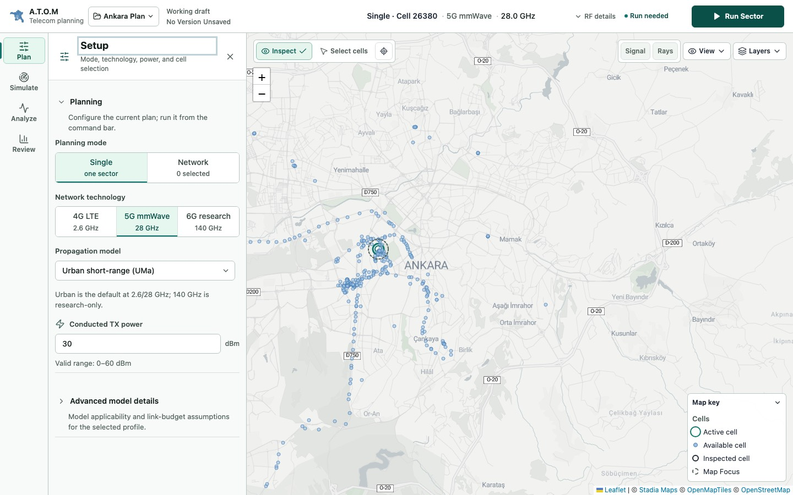
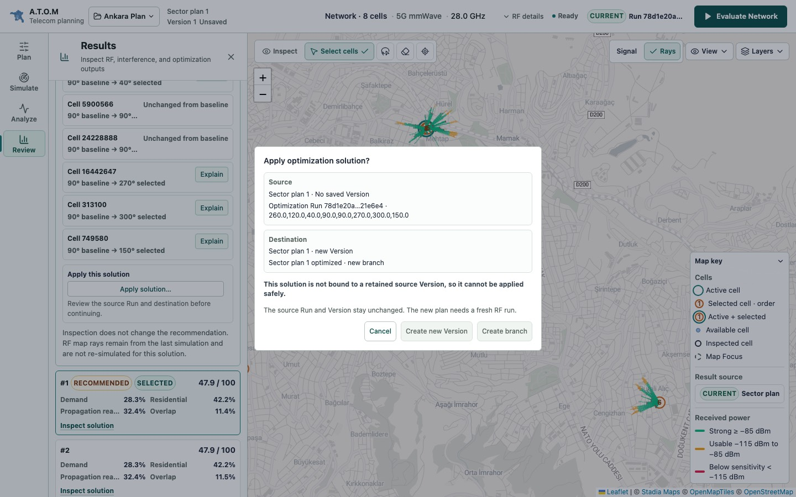
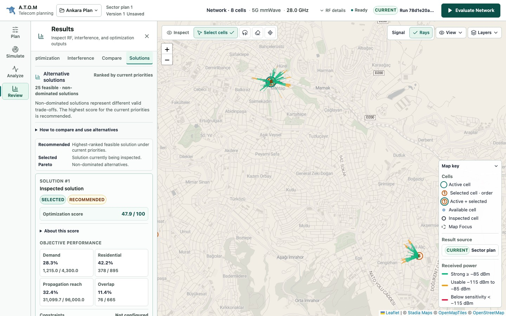
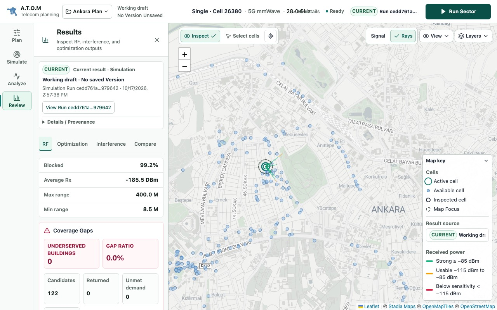

# A.T.O.M Product Capability, UX & Growth Audit

17 October 2026 · Read-only product audit · No implementation, no GitHub mutation

**Verdict: C — PRODUCT WORKFLOW GAPS.** A.T.O.M has a broad, scientifically careful capability set (38 user-facing capabilities). Its engines feel fast, and long operations report their progress well. The core planning loop, though, breaks at its transitions. Results finish off-screen. The first result looks like a failure. Pareto alternatives cannot be adopted after the default optimize path. Results do not survive a reload. Saved-scenario comparison is unreachable once a network result exists. Shared files get UUID names. Most fixes are bounded, product-safe UX and workflow work. Only a few need new semantics, and none needs new physics.

## 0. Baseline and lock

| Item | Value |
|---|---|
| HEAD | `d0763974e2b5b68c209fda5c680cdfd8b1bdde2a` (`d076397 chore: merge documentation fix and audit`) |
| Branch / status | `main`, clean tracked tree; empty `git diff --stat` |
| VERSION / describe | `0.12.3` / `v0.12.3-7-gd076397` |
| Current release | A.T.O.M v0.12.3, published 2026-10-16 |
| Audited runtime | `docker build` of HEAD as `atom:product-audit-d076397` on `127.0.0.1:18090`, compose defaults (RF 2/1 concurrency, 20/min, 60 s). `/api/meta` reports 0.12.3, `build_commit: unknown`. The pre-existing `atom-app` container (0.12.2) was not touched. |
| Audit lock | [`scripts/product-capability-ux-growth-audit/audit-lock.json`](../scripts/product-capability-ux-growth-audit/audit-lock.json), SHA-256 `c7f03dd0a9eeb935054d82dd6ba7f10402e6b35d0bb87f4f35bcc0eaf9496d9c`. Captured after browser evidence collection began and before any report was written. It holds hashes for 29 authoritative sources. |

**Live GitHub state.** Ten issues are open: #76 (scores/Pareto explanation), #78 (walkthrough docs), #79 (hero captures), #81 (report reading docs), #82 (contribution entry), #86 (roadmap reconciliation), and #87–#90 (blocked field-validation research). Recently merged: PR #96 (explain scores and Pareto), #95 (export guard recovery), #94, #93, #92 and #91. **#76 remains open although PR #96 merged on 2026-10-17.** The maintainer should verify it and close it. This audit changed nothing on GitHub.

**Prior work respected.** This audit builds on Concept 7F (product UX audit), Concepts 8A–8H (navigation, map chrome, roles, IA, visual system) and the v0.12.2 roadmap audit. It does not re-propose items those audits resolved or rejected, such as a dashboard, a command palette or extra permanent navigation.

## 1. Methodology

1. **Use the product.** Five Playwright scripts drove a fresh Chromium profile against the HEAD build ([`explore-*.mjs`](../scripts/product-capability-ux-growth-audit/)). They cover first run, single-sector run and optimization, network area selection, evaluation, optimization with live progress, Results, Solutions and Apply, Interference, Run history, Save version, Report Markdown download, project Export, reload continuity, every tool panel's empty state, injected error states (API down, `/api/towers` 500, RF 429/500/slow), invalid input, a 1440/1280/1024 × light/dark matrix and keyboard traversal. API requests, timings and ARIA snapshots are in [`traces/`](../scripts/product-capability-ux-growth-audit/traces/), and 34 curated captures are in [`screenshots/`](../scripts/product-capability-ux-growth-audit/screenshots/).
2. **Confirm in source.** Every HIGH finding is tied to a file and line in `frontend-react/src`. Anything that looked missing was searched for in the code before being called missing.
3. **Cross-check docs and backlog.** Checked against README, `docs/features.md`, `PRODUCT.md`, `planning/product-compass.md`, `planning/future_plans.md`, the glossary and the open and recently closed issues.
4. **Ratings are comparative aids.** The 1–5 scores are not measurements.

## 2. Product in one sentence and primary workflow

**A.T.O.M is a local-first, deterministic map workspace for configuring, analyzing and comparing small (2–8 Cell) urban 4G/5G plans on a validated Ankara dataset, with explained azimuth optimization and evidence that keeps its lineage.**

Primary workflow, matching the Product Compass: choose a plan mode → select Cells → **Run Sector / Evaluate Network** → inspect on the map → **Optimize** → review score, impact and alternatives → **apply** → **save a Version** → **compare** → **export a report or project**.

## 3. Capability inventory (Phase 1)

Full records, with entry point, workflow, backend, persistence, output, value, discoverability, maturity, limitations and evidence, are in [`capability-inventory.json`](../scripts/product-capability-ux-growth-audit/capability-inventory.json).

| Maturity | Count | Capabilities |
|---|---:|---|
| COMPLETE | 6 | Project lifecycle; inventory search/filter; network evaluation; map layers/basemap/appearance; headless API/CLI; Dataset Pack Studio |
| FUNCTIONAL BUT ROUGH | 23 | Draft autosave; Versions; branch/undo; project import/export; Cell editing; inventory import; Setup; area selection; Run Sector; sector auto-optimize; network optimization; per-cell explain; interference; signal surface; experiments; building entry; dataset/pack info; run history; reports; Inspector; map key; result lineage; building overlay |
| PARTIAL | 1 | Pareto alternative **apply** (blocked after the default path) |
| HIDDEN / POORLY EXPOSED | 5 | Scenario input diff; **two-scenario KPI compare**; **candidate recommendations**; path-profile diagnostic; **CSV measurement validation + calibration** |
| EXPERIMENTAL | 3 | Research references (sub-THz, P.1411, material, reflection); campaign-file RF diagnostics; 5G Core Lab |
| BLOCKED | 0 | — |

The rail has **14 tools in 4 stages**: Plan (Setup, Inventory, Scenarios), Simulate (Propagation, Experiments, Signal surface), Analyze (Interference, RF Diagnostics, Building entry, 5G Core) and Review (Results, Run history, Data, Report). `docs/features.md:7` still says "Ten workflow tools".

## 4. Product mental model and terminology (Phase 2)

| Concept | Introduced | Consistency | Debt |
|---|---|---|---|
| Project | Header menu | Good | — |
| Working draft / Scenario / Version | Header identity, Scenarios tool | **Drifts** | The header shows "Version 1 Unsaved" while Results shows "No saved Version" for the same state. The auto-name "Sector plan 1" sticks after switching to an 8-Cell network. The same action appears as "Save version", "Save Version" and "Saving scenario…", and its accessible name is "Save current". |
| Cell / sector / site / tower | Glossary (closed #80) | **Leaks** | The UI says "Cell", but notices, errors and the Report intro say "tower" ("272 towers found…", "No tower selected", "Export the selected tower…", "Cell No tower"). |
| Run | Command-bar chip, Run history | Hash-first | Labels such as "Run 1cfa19e7…5e048d" carry no type, size or metric. |
| Result freshness | CURRENT / STALE / UNAVAILABLE | Over-triggers | A mode switch marks the result "out of date". After a reload the bar reads "Ready · UNAVAILABLE". |
| Optimization / solution / recommendation / candidate | Results | **Overloaded** | "Recommended solution" (Pareto) and "candidate recommendation" (new Cell) are different things. The 5th Results tab switches between **Candidates** and **Solutions** depending on the last run. |
| Compare | Results, Scenarios | **Overloaded** | "Compare" means Baseline vs Recommended for network results and A vs B saved scenarios otherwise. The input diff is a third surface in Scenarios. |
| Measurement validation | Data, RF Diagnostics | **Collides** | Two different tools share the name; the one that changes canonical RF is labeled Research. |
| Report vs Reports | Report tool | Unclear | The immediate PDF/Markdown export also silently stores a "Report". The empty state says "Generate a Report", but no button has that name. |

The UI separates view actions (Signal/Rays toggles, ray scope, Map key) from model actions (Run, Optimize, Apply), and view toggles send no RF requests, which existing E2E tests also verify. Plan-mode switching is the exception: it is a view-level choice but is reported as a model change.

## 5. First-time user audit (Phase 3)



- **Immediately visible:** the A.T.O.M name, "Telecom planning", project "Ankara Plan", a pre-selected Cell 26380 at 5G 28 GHz, the open Setup drawer, a city-wide map with about 450 Cells, and one strong primary action, **Run Sector**. DOM is ready at 100 ms and the network is idle at about 1.07 s, with 4 API calls and no console errors.
- **Purpose and next step:** the obvious first action is clear. Its *outcome* is not explained, and nothing says what A.T.O.M is for beyond "Telecom planning".
- **Sample data:** the dataset is preloaded, which is a strong moment. The bundled `examples/ankara-sample.atom-project.json` is reachable only by reading README line 180 and importing it.
- **Journey to a first result:** 1 decision and 1 click. The run takes 167–281 ms, **but the map does not move** (F01). The visible change is a "CURRENT Run 1cfa19e7…" chip and a few unreadable ray stubs at city zoom.
- **What the first result says:** Blocked **99.2%**, Average Rx **−185.5 "DBm"**, Max range **400.0 "M"**, next to a red **Coverage Gaps** card with 0 underserved, 0.0% and Worst Rx 0.0 dBm (F02, F03, F34). With 4G it is 84.2% blocked. A newcomer reads this as "broken".
- **First network result:** Network → Select cells → Draw area → 4 clicks → Finish → Evaluate is 5 decisions and about 8 clicks. The notice reads "272 towers found, nearest 8 selected" (F10). The Map key swallowed one vertex (F11).
- **Strong moments:** fast runs; one primary action; disabled tools explain why ("Interference requires Network planning mode"); optimization reports live progress ("8 cells · 2 passes · 578 proposals · 1.3 s elapsed"); the 429 message gives a concrete wait time.

**Assessment.** No wizard is needed: the command bar already teaches the first action. What is missing is (a) the result landing in view, (b) a one-line reading of the result, and (c) a visible path to the sample network project. A dismissible first-run card plus auto-fit covers this (O01, O02, O10).

## 6. Core workflow audit (Phase 4)

Scores run from 1 (poor) to 5 (strong): **D**iscoverability, **C**larity, **E**fficiency, Co**n**fidence, **R**ecoverability, **P**olish.

| Workflow | Entry | Steps | Hidden prerequisite / break | D | C | E | N | R | P |
|---|---|---:|---|:-:|:-:|:-:|:-:|:-:|:-:|
| First single-sector run | Command bar | 1 | No fit; uninterpreted result | 5 | 2 | 5 | 2 | 3 | 4 |
| Network selection | Setup → Network, map toolbar | 5–8 | Silent nearest-8; legend swallows clicks | 3 | 3 | 3 | 3 | 3 | 3 |
| Network evaluation | Command bar | 1 | Not fitted | 4 | 3 | 4 | 3 | 3 | 4 |
| Network optimization | Simulate → Propagation | 3 | Goals behind "Advanced analysis" | 3 | 4 | 3 | 4 | 3 | 4 |
| Inspect/apply alternative | Results → Solutions | 3–4 | **Apply disabled without a pre-saved Version** | 3 | 3 | 2 | 2 | 1 | 3 |
| Interference | Analyze → Interference | 2 | No summary in the tool | 4 | 3 | 3 | 3 | 3 | 3 |
| Candidate recommendation | Results → 5th tab | 4+ | Tab replaced after optimization; needs 2–5 Cells and an area | 1 | 3 | 2 | 3 | 2 | 3 |
| Save Version | Project menu / Scenarios | 2 | Naming drift; pre-save runs not bound | 3 | 2 | 3 | 2 | 4 | 3 |
| Reopen / continue | Automatic | 0 | Results not restored | 5 | 2 | 3 | 2 | 2 | 3 |
| Compare plans | Results → Compare / Scenarios | 3–5 | Unreachable with network results | 2 | 3 | 2 | 3 | 3 | 3 |
| Report / export | Review → Report, project menu | 1–2 | UUID filenames; duplicated sections | 4 | 2 | 4 | 3 | 3 | 2 |
| Measurement validation | Data → Research | 4 | Filed as research | 1 | 3 | 3 | 3 | 3 | 3 |
| Signal surface / GIS | Map Signal toggle | 1–2 | — | 4 | 4 | 4 | 4 | 3 | 4 |
| Experiments | Simulate → Experiments | 3 | Single active Cell, unstated in Network mode | 3 | 3 | 2 | 3 | 3 | 3 |

**Biggest break: alternatives cannot be adopted (F04).** Users normally optimize in the working draft. The resulting run has no `scenario_revision_id`, so **Apply solution…** opens a dialog with both actions disabled: "This solution is not bound to a retained source Version, so it cannot be applied safely" ([ApplySolutionDialog.jsx:13,55-60](../frontend-react/src/components/ApplySolutionDialog.jsx)). Optimization does write the *recommended* azimuths into the draft ([App.jsx:1217](../frontend-react/src/App.jsx)), but the UI never says so. No recovery step is given, even though App already has the right message ("Save a Scenario Version before applying…", [App.jsx:3139](../frontend-react/src/App.jsx)).



## 7. UI behavior audit (Phase 5)

**Silent actions**
- A completed run leaves the map in place (F01).
- A mode switch silently marks the result STALE (F09).
- Area selection silently drops 264 of 272 Cells (F10).
- After Analyze Interference the Interference panel looks unchanged (F12).
- PDF/Markdown export silently creates a stored Report.

**Dead clicks**
- "Apply solution…" opens a dialog whose actions are all disabled (F04).
- The icon-only **Fit selected cells** is the only route to seeing results.
- At 1024 px the Signal and Rays toggles leave the toolbar.

**Good behavior**
- Disabled tools carry reasons in `aria-describedby`.
- The primary button changes label with state ("Select cells", "Evaluate Network", "Resolve setup issues").
- Optimization progress is live and cancellable through state.
- View toggles never trigger RF requests.
- Delete has Undo.
- Apply uses a modal with explicit Source and Destination.

**Weak behavior**
- The project menu does not close on Escape, and its trigger keeps the label "Open project menu" while open (F17).
- Invalid input (TX power 99) shows no inline error or `aria-invalid`, disables the primary as "Resolve setup issues", and the map prompt sends the user to **Inventory**, while the field is in Setup (F19).

## 8. Map UX audit (Phase 6)

- **Strengths:** clear marker vocabulary (active, selected with order number, active+selected, inspected, focus); a legend tied to visible layers; a result-source chip; good dark-mode parity; rays read well once zoomed.



- **Problems:**
  - Results are not fitted (F01).
  - Single-sector fit is too wide for a 400 m result (F32).
  - At city zoom roughly 450 Cells cluster into indistinct blobs, and the 8 selected Cells sit at 2 co-located sites that are hard to tell apart.
  - The Map key swallows drawing clicks and clips the SINR legend at 1440×900 (F11).
  - The drawn area persists after an unsuccessful selection, and at street zoom nothing hints where Cells are.
  - Keyboard users can focus only the active marker; result layers are canvas (F29).
- **Not recommended:** clustering, heatmaps or 3D, which are decorative relative to the planning questions asked here.

## 9. Tool and panel audit (Phase 7)

| Tool | Feels like | Main issue |
|---|---|---|
| Setup | Coherent task | Invalid-value feedback; "cell selection" in the subtitle, but selection happens on the map |
| Inventory | Coherent task | 1,080 px single-Cell editor; no bulk edit or undo; empty until you search |
| Scenarios | Collection of controls | Save, list, provenance and a collapsed compare in one scroll; lives in Plan, far from Review |
| Propagation | Mixed | Ray/geometry sliders, **Optimize** and **optimization goals** (inside "Advanced analysis"), path profile and research references in one drawer |
| Experiments | Coherent task | Comma-text sweeps; single-Cell scope unstated in Network mode |
| Signal surface | Coherent task | Good boundary copy |
| Interference | Coherent input, no output | No result summary or next step (F12) |
| RF Diagnostics | Collection | Entry buttons plus research; collides with Data's measurement validation |
| Building entry | Coherent task | Good boundary copy |
| 5G Core | Coherent task | Optional sidecar |
| Results | Decision surface, overloaded tabs | Tab overflow (F20); Compare/Candidates switch meaning (F05, F06); 25 near-identical solution cards (F24) |
| Run history | List | Hash labels (F23) |
| Data | Collection | Dataset QA plus a **buried canonical calibration** (F07) |
| Report | Two concepts in one panel | Export vs stored Reports; lineage contradictions (F15) |

## 10. Result experience (Phase 8)

The Results card answers **what produced this** well: CURRENT badge, Scenario/Version, Run, Details/Provenance. The **optimization summary** (score, impact deltas, "Recommended solution", "About this score" from PR #96) is the strongest decision surface in the product. Gaps:

- **Good or bad?** The single-sector RF view has no interpretation, and its gap card contradicts its blocked ratio (F02).
- **What changed?** Network Compare is limited to baseline vs recommended. Saved-plan comparison is unreachable (F06), and *where* plans differ on the map is never shown (O16).
- **What next?** Interference ends without a next step (F12). The Optimization empty state sends users to Propagation (F26). After a solution is applied, the user must remember to run again.
- **Can I preserve or reproduce it?** Saving does not bind runs made before the save (F08, F15). Run history labels are unreadable (F23).
- **Can I compare alternatives?** 25 cards show near-identical numbers ("Demand 28.3%" on every card) with no trade-off chart, although Experiments already renders one (F24).

## 11. Information hierarchy (Phase 9)

- **Loud, low-value:** the red Coverage Gaps alert when there are no gaps (F34); repeated "Working draft · No saved Version" (header, Results card, legend chip); full run hashes in primary positions.
- **Quiet, high-value:** **Fit selected cells**, an icon only; **Optimize Network**, inside Propagation; optimization priorities, inside "Advanced analysis"; **Candidates**, the clipped 5th tab; **Measurement Validation**, inside a Research disclosure.
- **Compressed:** the Results tab strip at every width (403 px of content in a 295–335 px viewport); the command bar at 1280 px, where "28.0 GHz" overprints "RF details" (F21).

The established visual system (Concept 8H tokens) holds up. No restyling is needed.

## 12. Navigation and information architecture (Phase 10)

```
Header: Project menu (projects, import/export, Save version, Scenario list) · Plan/Scenario/Version identity · RF context · status/run chip · Primary action
Rail:   Plan [Setup | Inventory | Scenarios] · Simulate [Propagation | Experiments | Signal surface]
        Analyze [Interference | RF Diagnostics | Building entry | 5G Core] · Review [Results | Run history | Data | Report]
Map:    Inspect / Select cells (+ Draw / Clear / Fit) · Metric · Signal · Rays · View (ray scope) · Layers (Appearance, Basemap, buildings) · Map key
```

Where users would not expect things:
- Optimize sits in *Simulate*, while its results are in *Review*.
- Version save is in both the header menu and *Plan → Scenarios*.
- Comparison is split between *Plan → Scenarios* and *Review → Results*.
- The CSV measurement workflow is in *Review → Data → Research*.
- Appearance is in *Layers* (F27).

The proposed IA changes are minimal and none adds a rail tool:
1. Optimization and candidate search become *actions next to the network result* (O06, O14).
2. Comparison gets one home, in Results (O05).
3. CSV Measurement Validation gets a first-class location (O11).

## 13. Empty, loading and error states (Phase 11)

| State | Observed | Actionable? |
|---|---|---|
| First run | Setup open, Run Sector ready | Partly: no outcome preview |
| No network (<2 Cells) | Primary becomes "Select cells"; Results empty states give a reason and an action | Yes |
| Tool unavailable | Reason shown in chooser and drawer, with a switch action ("Switch to Network mode", "Use 5G mmWave") | **Yes, strong** |
| No result (Results, Run history, Reports, Scenarios) | Consistent `AnalysisEmptyState` with an action | Yes |
| Stale result | Map prompt plus STALE chip; "Run again" in Results | Yes, but over-triggered (F09) |
| Backend unreachable | "Failed to fetch"; "Cell No tower"; primary disabled | **No** (F18) |
| `/api/towers` 500 | "dataset load failed" passed through | Partly |
| RF 500 | "internal error" | **No** |
| RF 429 | "RF request budget reached. Try again in about 17 seconds." | **Yes, strong** |
| Slow RF (6 s) | Status "Simulating", primary "Running…" | Yes, honest |
| Invalid input | Primary disabled; no field error; prompt points to Inventory | **No** (F19) |
| Apply without Version | Disabled actions, no recovery | **No** (F04) |
| Reload after save | "Ready · UNAVAILABLE · Run unavailable" | **No** (F08) |

There is no fake progress anywhere, which is good.

## 14. Perceived performance (Phase 12)

On loopback with the HEAD image: initial idle 1.07 s; Run Sector 0.17–0.28 s; Auto-Optimize Sector 1.83 s; Evaluate Network (8 Cells) 0.82 s, as 1 evaluate plus 8 simulate requests; Optimize Network 5.1–6.1 s with live counters; Interference 1.76 s; reload to ready 2.56 s. No freezes or layout jumps were observed. Perceived slowness comes almost entirely from **not seeing** results (F01, F32), not from waiting. Expensive actions are labeled ("Optimize", "Analyze"), but the UI never says when an action triggers several RF calls; Evaluate fans out to 9.

## 15. Persistence and continuity (Phase 13)

What users can infer, and what is actually true:

- **Draft inputs** autosave and are restored. The UI says so in the project-menu note. ✔
- **Results are not restored** on reload. The draft shows "Run needed". A saved Version shows "UNAVAILABLE", because runs made before the save stay bound to "Working draft · No saved Version". Run history still lists them. This reads as data loss (F08).
- **Exports** include retained Scenario evidence and exclude Run History and coverage surfaces. The menu discloses this in a dense single paragraph. A one-Version export was 609 KB, named `ankara-plan.atom-project.json`, with no date or Version (F13).
- **Reports** keep their source Scenario, Version and Runs. Their filenames are UUIDs.
- **Not exercised here:** project import round trip and v1/v2 compatibility, which are covered by existing E2E/unit suites and the persistence reliability audit.

## 16. Reporting and sharing (Phase 14)

Report generation is easy to find in Review → Report, PDF/Print is the primary action, and limitations and methodology sections are present. Another engineer would still struggle:

- The file is `f079b4f3-b688-4148-9fc3-5289e4c1523a.md` (F13).
- "RF Result" and "RF Propagation Performance" are identical tables. The executive "RF result" table holds only "Constraints: Not configured" for a single Cell (F14).
- About 600 lines of inline SVG (82 KB) do not render in many Markdown viewers.
- Lineage contradicts itself: "Version 1 · Runs: None" next to a source card that said "No saved Version", with a HISTORICAL badge on a report created seconds earlier (F15).

The report makes no claims of physical accuracy, which is correct.

## 17. Accessibility (Phase 15)

- **Strong:** skip link; 2 px solid focus outlines on every observed tab stop; stage tooltips; unavailable reasons in `aria-describedby`; labeled sliders and spinbuttons; text badges (CURRENT, RECOMMENDED, SELECTED) rather than color alone; Pareto roles explained in text; Apply dialog is modal with initial focus on Cancel.
- **Material problems:**
  - The project menu has no Escape handling (F17).
  - Visible "Save version" has the accessible name "Save current", a label-in-name mismatch (F16).
  - Two controls share the name "Select cells" (F31).
  - Invalid fields lack `aria-invalid` (F19).
  - Only the active marker is keyboard-focusable, and the keyboard alternative (Inventory search) is not signposted (F29).
  - The programmatic heading-focus outline looks like a text input (F30).
- No automated axe checks or screen-reader sessions exist in CI.

## 18. Light/dark and visual polish (Phase 16)

Dark parity is good at every size checked: tokens hold, contrast is adequate and the basemap switches with the theme.

| Size | Issue |
|---|---|
| 1440×900 | Results tabs overflow (5th tab clipped); legend "Working dr…" truncated; SINR legend clipped |
| 1280×800 | **"28.0 GHz" overprints "RF details"** (F21) |
| 1024×768 | Project name "Ankara …", RF context drops technology, Signal/Rays leave the toolbar; still usable |

These are usability problems (overlap, clipping, hidden controls), not matters of taste. The `DBm`/`M` unit rendering (F03) is a correctness-adjacent polish bug.



## 19. Discoverability (Phase 17)

| Capability | Rating | Fix type |
|---|---|---|
| Run Sector / Evaluate Network | Obvious | — |
| Fit selected cells | Learnable (icon only) | Auto-fit and a better label |
| Network optimization | Learnable | Placement next to the result (O14) |
| Optimization goals and constraints | Hidden | Placement, with a summary near the action |
| Pareto alternatives | Learnable | Chart (O12) |
| **Candidate recommendation** | **Effectively undiscoverable** | Workflow restructuring (O06) |
| **Two-scenario compare** | **Effectively undiscoverable in Network mode** | Workflow restructuring (O05) |
| Scenario input diff | Hidden | Merge into Compare |
| **CSV measurement validation** | **Effectively undiscoverable** | Placement and label (O11) |
| Path profile | Hidden | Contextual entry from the Inspector |
| Sample project | Documentation only | Empty state (O10) |
| Appearance | Hidden in Layers | Label or placement |

## 20. Friction map (Phase 18)

All 34 items, with category, severity, frequency, effort, impact and evidence, are in [`friction-map.json`](../scripts/product-capability-ux-growth-audit/friction-map.json).

HIGH severity:

| ID | Finding | Category | Freq | Effort |
|---|---|---|---|---|
| F01 | Map does not move to new results | Weak feedback | High | S |
| F02 | First result reads as failure, with contradictory metrics | Result interpretation | High | S |
| F04 | Pareto alternatives cannot be adopted after the default path | State confusion | Medium | M |
| F05 | Candidate recommendations effectively hidden | Discoverability | Medium | M |
| F06 | Scenario comparison unreachable with network results | Discoverability | Medium | M |
| F08 | Results do not survive reload | Persistence | High | M |

MEDIUM severity: F03, F07, F09–F15, F17–F19, F21–F24, F26, F29, F32, F34. LOW severity: F16, F20, F27, F28, F30, F31, F33.

## 21. Missing capabilities (Phase 19)

Each gap starts from an observed break, not a feature list.

| Gap | Who / when | Decision enabled | Why existing features fall short | Type |
|---|---|---|---|---|
| Spatial "where did it change" between two plans | Planner defending a recommendation | Which demand is gained or lost | Only aggregate deltas exist | Backend/product feature (B) |
| Area-of-interest KPIs | Planner asked to cover a district | Does this plan serve the target area? | KPIs are network-wide; the polygon only selects | Backend/product feature (B) |
| Multi-sector site placement | Planner adding a 3-sector site | Faster, realistic layout | Three manual placements; "site" exists only in the glossary | Frontend + schema (B) |
| Self-contained review package | Sharing with a reviewer | Review without operating A.T.O.M | Separate, generically named downloads | Frontend feature (A) |
| Result continuity | Returning user | Resume where they left off | Summaries exist but are not rebound | Technical foundation (C) |
| Network-scope sensitivity | Robustness check | How fragile is the plan? | Experiments are single-Cell | Technical + policy (C) |
| Edit undo | Iterative editing | Safe exploration | Only delete-undo | Technical foundation (C) |
| Measured accuracy or confidence | Trust | How wrong could this be? | No authoritative field truth | Scientific (D, #87–#90) |

## 22. Feature opportunities and safety classification (Phases 20–22)

All 28 candidates are in [`product-opportunities.json`](../scripts/product-capability-ux-growth-audit/product-opportunities.json), each with problem, workflow, behavior, insufficiency, value, surfaces, risk, dependencies, effort, safety class and polish/feature class.

| Safety class | Opportunities |
|---|---|
| A. Product-safe now | O01 auto-fit; O02 result interpretation; O05 one Compare; O06 candidate action; O07 shareable outputs; O08 state language; O09 actionable errors; O10 first-run sample; O11 measurement placement; O12 Pareto chart; O13 map chrome; O14 optimize near result; O15 accessibility; O19 review package |
| B. Bounded semantic change | O03 adopt from draft (create a source Version from retained run input); O16 Decision Compare spatial delta; O17 AOI KPIs; O18 site template |
| C. Technical foundation required | O04 result continuity; O20 edit undo; O21 network-scope experiments |
| D. Scientific evidence required | O22 calibrated or confidence-weighted predictions; O23 tilt/power/site-selection optimization |
| E. Reject | O24 wizard; O25 cost/backhaul/equity scoring; O26 cloud collaboration; O27 command palette (not now); O28 3D city view |

By kind: **Polish** O13; **UX repair** O01, O02, O07, O08, O09, O15; **Workflow improvement** O03, O05, O06, O10, O11, O12, O14; **Product feature** O16–O19, O21; **Technical debt** O04, O20; **Scientific/research** O22, O23.

## 23. "One click less" pass (Phase 23)

- **Run, then find the result:** drop the manual Fit (O01).
- **Select an area, then find what was selected:** fit and list the chosen Cells (CI-16).
- **Evaluate, then Optimize:** offer Optimize from the evaluated result instead of Simulate → Propagation (O14).
- **Optimize, then adopt an alternative:** remove the forced save-and-re-optimize (O03).
- **Reload, then re-run:** reuse the retained summary; restore layers only on request (O04).
- **Compare two Versions:** one surface instead of choosing between Scenarios and Results (O05).
- **Repeat exports:** dated names remove the manual rename (O07).
- Safety confirmations stay: Apply keeps its Source/Destination modal, and project delete keeps its confirmation.

## 24. "What happens next?" pass (Phase 24)

| Completion state | Next action obvious? |
|---|---|
| After adding or placing a Cell | Partly: the editor opens; Run is in the command bar |
| After configuring RF | Yes: command bar |
| After a propagation result | **No:** off-screen, with no hint to fit, optimize or open Results |
| After network evaluation | Partly: Results are populated; Optimize is two stages away |
| After optimization | Yes: Results shows impact, "View comparison" and "Explore solutions" |
| After choosing an alternative | **Dead end** when Apply is blocked |
| After applying a solution | Partly: a notice says to run again; no run button in the notice |
| After interference | **Dead end** in the tool |
| After saving | Partly: "Version saved"; no suggestion to compare or export |
| After report generation | Partly: the download happens; the stored Report shows contradictory lineage |

## 25. Trust pass (Phase 25)

**Where users could over-infer:**
- "Optimization score 64.4 / 100" could read as absolute quality. PR #96's "About this score" mitigates this inside Results, but the score appears without that context in the command-bar flow.
- "Recommended" could read as optimal. The copy correctly says "highest score for the current priorities".
- "Pack QA status good" could read as RF accuracy. It is geometry and hash QA.
- Candidate "recommendations" could imply site availability. This is mitigated in docs and needs the same line in the UI.

**Where caution costs usability:**
- Research-boundary text repeats in Setup, Propagation and the drawer descriptions.
- The project-menu persistence paragraph packs four rules into one sentence.
- The Apply dialog states a safety rule but gives no remedy.
- Data hides the CSV calibration workflow as "Research" even though it is a supported, explicit, documented action.

**Recommendation:** use clearer boundaries, not more disclaimers. Add one deterministic interpretation line per result, an inline "what this is not" on the specific object, and a remedy wherever an action is refused. Lineage identity (Run, Version, dataset and model fingerprints) is a real strength. Make it readable (O08), not louder.

## 26. GitHub cross-check (Phase 26)

| Existing issue | Relation to findings |
|---|---|
| #76 Explain normalized scores / Pareto | **Covered** by merged PR #96; the issue is still open. The Pareto *chart* (O12, CI-15) is new. |
| #78 Baseline-to-recommendation walkthrough (docs) | **Partial:** complements the in-product first-run card (O10, CI-14) |
| #81 How to read and preserve a report (docs) | **Partial:** complements report naming and content fixes (O07, CI-07, CI-08) |
| #86 Roadmap reconciliation (docs) | **Fold in:** the features.md "Ten workflow tools" drift (F28) |
| #79, #82 | Unrelated docs and community work |
| #87–#90 Field-validation research | **Covered as research:** O22 depends on them; the measurement *placement* fix (O11) is UX-only and new |
| Closed #80 Cell/site/tower glossary | **Residual:** UI copy still says "tower" (CI-16) |
| Closed #77 Export guard recovery | Related area; filename and dating are new (CI-07) |

## 27. Roadmap proposal (Phase 27, not tied to releases)

- **NOW:**
  - O01 + O02 results land and read
  - O03 adopt alternatives from the draft
  - O07 shareable outputs
  - O08 precise state language
  - O09 actionable errors
  - O10 first-run sample
  - O13 map chrome
  - O15 accessibility
- **NEXT:**
  - O04 result continuity
  - O05 one comparison surface
  - O06 candidate action
  - O11 measurement placement
  - O12 Pareto chart
  - O14 optimize near result
  - O17 AOI KPIs
- **LATER:**
  - O16 Decision Compare spatial delta
  - O18 multi-sector site template
  - O19 review package
  - O20 edit undo
  - O21 network-scope experiments
- **RESEARCH / BLOCKED:**
  - O22 calibrated confidence (#87–#90)
  - O23 tilt/power/site-selection optimization
- **REJECTED / NOT NOW:**
  - O24 wizard
  - O25 cost/backhaul/equity scoring
  - O26 cloud collaboration
  - O27 command palette
  - O28 3D view

## 28. Top 10 product opportunities (Phase 28)

| # | Title | Class | User problem | Impact | Effort | Risk | Prerequisite | Why now |
|---|---|---|---|---|---|---|---|---|
| 1 | Make every result land and read (O01+O02) | UX repair | Results off-screen; first result looks like failure | Every run legible | S | Low | — | Touches 100% of runs and the first impression |
| 2 | Adopt any optimization solution from the draft (O03) | Workflow (B) | Alternatives cannot be applied | Closes the optimize → decide loop | M | Low–med | Run fingerprints (exist) | Caps the value of the just-shipped Pareto explanation |
| 3 | Result continuity on reopen (O04) | Tech debt (C) | Reload looks like data loss | Returning-user trust | M | Medium | Retention policy | Persistence is a core promise |
| 4 | One comparison surface (O05) | Workflow | Scenario compare unreachable | Restores a documented capability | M | Low | — | Foundation for Decision Compare |
| 5 | Shareable reports and exports (O07) | UX repair | UUID names, duplicate sections | Hand-off quality | S | Low | — | Pairs with #81 |
| 6 | Precise state language (O08) | UX repair | Over-triggered stale states, hashes | Fewer second guesses | S | Low | — | Cheap, broad |
| 7 | Candidate recommendation as a primary action (O06) | Workflow | Hidden capability | Unlocks an implemented workflow | M | Low | — | Best value per line among hidden features |
| 8 | Actionable errors and inline validation (O09) | UX repair | Raw errors; misdirected prompt | Recovery | S | Low | — | First-run local setups hit these |
| 9 | First-run sample entry (O10) | Workflow | No orientation | Network result in ≤3 actions | S | Low | — | Complements #78 |
| 10 | Measurement validation placement (O11) | Workflow | Canonical feature filed as research | Exposure | S | Low | — | #87–#90 will raise its importance |

## 29. Feature shortlist: genuinely new capabilities (Phase 29)

**1. Decision Compare with spatial delta layer (O16, B, L).**
- *Limitation:* only aggregate KPI deltas exist; the map cannot show where two plans differ.
- *Experience:* pick any two states (current, baseline, saved Version, Pareto alternative). The map shows demand buildings *newly served*, *newly lost* and *overlap changed*, with counts and a report section.
- *Concept:* compare per-building served state from two results with identical dataset and model fingerprints.
- *Backend/API:* add a bounded per-building served-state array to evaluation responses, or a deterministic recompute endpoint; respect existing response bounds.
- *Science:* none new; this re-presents existing classifications.
- *MVP:* two network results with identical fingerprints; three delta classes.
- *Out of scope:* SINR deltas, comparisons across models or datasets, animation.

**2. Area-of-interest KPIs (O17, B, M).**
- *Limitation:* KPIs are network-wide; the drawn polygon only selects Cells or candidates.
- *Experience:* keep the drawn area as an AOI and show served demand weight, residential served and overlap *inside the AOI* next to network-wide values, and in reports.
- *Backend:* an optional bounded `aoi` polygon filter on evaluation statistics. Polygon complexity is already bounded (closed #16).
- *Science:* aggregation only.
- *MVP:* one AOI on evaluation and optimization summaries.
- *Out of scope:* AOI-driven optimization objectives, multiple AOIs, imported boundaries.

**3. Multi-sector site template (O18, B, M).**
- *Limitation:* a three-sector site needs three placements and three azimuth edits.
- *Experience:* "Place site (3 sectors)" creates co-located Cells at 0/120/240° that can be moved and edited as a group.
- *Data:* an optional group ID in the inventory and project schema. Requests still send N Cells, so the API is unchanged.
- *Science:* none. The copy must follow the glossary and not imply site feasibility or ownership.
- *MVP:* create and move as a group; ungroup.
- *Out of scope:* shared-antenna modeling, site cost, mast height optimization.

**4. Review package export (O19, A, M).**
- *Limitation:* sharing needs several generically named downloads.
- *Experience:* "Export review package" produces a zip with the HTML and Markdown report, project file, map PNG and a manifest (hashes, dataset and model identity, limitations).
- *Backend:* none.
- *Science:* none; provenance is reused.
- *MVP:* the current Version only.
- *Out of scope:* hosted sharing links, signatures.

## 30. Quick wins (Phase 30)

| ID | Win | Finding | Effort |
|---|---|---|---|
| QW1 | Drop `text-transform: capitalize` from metric values (`styles.css:1161`) | F03 | XS |
| QW2 | Neutral zero-gap card; "—" for unavailable Worst Rx | F34 | XS |
| QW3 | Dated, named report and project filenames | F13 | XS |
| QW4 | One "Save version" label, casing and accessible name | F16 | XS |
| QW5 | Escape closes the project menu; expanded-aware trigger label | F17 | XS |
| QW6 | "Cell" wording; explain the nearest-8 rule and list the chosen Cells | F10, F33 | XS–S |
| QW7 | Collapse the Map key while drawing; scrollable legend | F11 | S |
| QW8 | Fit Results tabs at desktop widths | F20 | S |
| QW9 | Interference summary plus "Open in Results" | F12 | S |
| QW10 | Correct the features.md tool inventory (via #86) | F28 | XS |

## 31. Design-system debt (Phase 31)

Real instances only:

- **Two Pareto presentations:** an SVG chart in Experiments and a card list in network Solutions.
- **Two comparison patterns:** a delta table in Results/Compare and a diff in Scenarios.
- **Mixed case:** "Save version" / "Save Version"; "Coverage Gaps" (title case) next to sentence-case headings; "Map Focus" in the Map key.
- **Inconsistent status presentation:** CURRENT/STALE/UNAVAILABLE badges in the command bar, Results card and Map key show different amounts of text, truncated differently ("Working dr…", "Run unav…").
- **Inconsistent "result present" signals:** "•" badges on some tools only (Surfaces, Interference, Building entry, Results), with none on Propagation.
- **Inconsistent empty states:** `AnalysisEmptyState` is used in Results; Inventory, RF Diagnostics and path profile use one-off empty-note paragraphs.
- **Inconsistent selection vocabulary:** "Selected" in the Map key and Pareto, "Inspected" for Inspector targets, "Active" for the single Cell; the Pareto card shows "SELECTED" and "Inspected solution" together.
- **Same concept, different words:** tower/Cell; Candidates/Solutions in the same tab slot; "recommendation" for both a Pareto pick and a candidate Cell.

## 32. UX test gaps (Phase 32)

- **No visual baselines** (light/dark × 1440/1280/1024) for first run, Results and Solutions. This would catch F20, F21 and F11.
- **No automated accessibility smoke** (axe) on the main drawers and dialogs. This would catch F16, F17 and F31.
- **No workflow test for** apply-from-unsaved-draft (F04), Compare reachability in Network mode (F06), candidates after optimization (F05), or fit-after-run (F01).
- **No error-copy tests** for API unreachable or 500 (F18). 429 is covered.
- **Report filename assertion** checks only `.md` (`e2e/workspace.spec.js:1863`).
- **No persistence round trip** for result context after save and reload (F08).
- **Existing strengths:** no-hidden-request assertions for view toggles, eight-Cell capacity, deadline and request-budget flows, and persistence reliability.

## 33. Evidence package (Phase 33)

Screenshots (JPEG, curated) are in [`screenshots/`](../scripts/product-capability-ux-growth-audit/screenshots/), with first run in both themes, single and network results, area drawing, Solutions, Compare, Apply, Report, reload, error states, the size/theme matrix, keyboard focus, layers and the Inventory editor. Traces are in [`traces/`](../scripts/product-capability-ux-growth-audit/traces/): `first-run.json`, `workflow-walk.json`, `tools-walk.json`, `states-walk.json`, `defaults-walk.json`, `sample-report.md`, `sample-export-summary.json` and the GitHub snapshots. Every HIGH friction item lists source lines plus a screenshot or trace in `friction-map.json`.

## 34. Proposed issues (not filed)

[`candidate-issues.json`](../scripts/product-capability-ux-growth-audit/candidate-issues.json) holds 17 proposed issues (CI-01 … CI-17). Each has title, classification, priority, area, problem, scope, acceptance criteria, non-goals, evidence, effort, contributor suitability, dependencies and a GitHub cross-check. Two findings fold into existing work instead (F28 → #86; verify and close #76). **Nothing was created, closed or edited on GitHub.**

## Limitations

- Only Chromium (Playwright 1.61.1) was used: no Firefox or Safari, no screen-reader session, no real users.
- Timings are from loopback on one Apple-silicon laptop.
- Inventory import, project import, Building entry, Experiments execution, research references, measurement CSV upload and the 5G Core sidecar were reviewed through panels and source, not run end to end.
- Phone and tablet layouts were not re-audited; that is Concept 7F/8B scope.
- The local Node install needed a library-path workaround to run Playwright. No product code was involved.
- The audit lock was captured after browser evidence collection started but before any report was written; tracked files were unchanged throughout.

## What A.T.O.M should feel like after this work

Every run lands in view and says in one plain sentence what it shows. Any solution, recommended or alternative, can be adopted in one confirmed step. Any two planning states can be compared in one place, and eventually on the map. Tomorrow's session opens where today's ended, with honest freshness labels. A colleague receives one clearly named file that explains itself. The scientific boundaries stay exactly where they are; they become easier to read, not louder.
