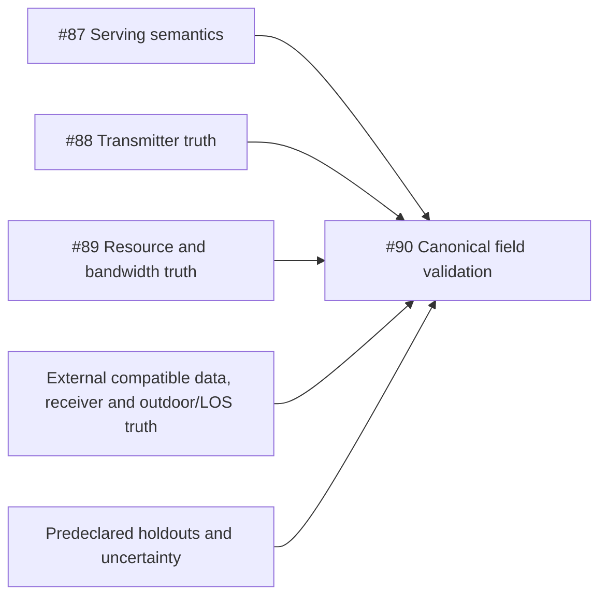

# A.T.O.M v0.12.2 Roadmap + Contribution Readiness Audit

15 October 2026 · Audit and repository management only · No backlog implementation

**B — ISSUES READY — PROJECT ORGANIZATION INCOMPLETE.** Fifteen evidence-backed issues and useful labels are live. Projects v2 discovery was denied because the token lacks `read:project`; no Project, field, view or membership result is claimed. Measured real-world RF accuracy remains unestablished.

## Baseline, authority and lock

Clean main; HEAD 0310bd8dea2e807ea57696a1bc5b3e11286db39e; VERSION 0.12.2; empty tracked diff/stat; origin Berk-Unsal/atom. Local/remote annotated v0.12.2 and remote main resolve to this commit; published release verified.

pre-audit-lock.json; SHA256 aa29b95e15d3afb859827c913edb031998cce02c5dcb174ba0fc7b75028db2d7. Original lock preserved; predeclared supplement permits only two report catalog entries.

The pre-audit lock records the commit/tree and SHA-256 identities of the maintained authoritative sources. A separate scope supplement, recorded before the edit, permits exactly two audit-report catalog entries. Original catalog entries are preserved; production code and historical evidence remain frozen.

Evidence is current source and committed screenshots plus live authenticated GitHub REST/GraphQL reads. The retained post-release audit describes historical findings; claim reconciliation and current source determine whether they remain. No new physical measurement, qualification, full browser journey, user-timing or accessibility certification is claimed.

## Existing GitHub state and discoverability

Before mutation: **32 issues, 0 open, 32 closed**, separately 43 PRs including 7 open. Thus there were no stale/unlabeled open issues and no existing open roadmap to reuse. Closed themes covered request/resource security, persistence, duplication and maintainability. Full bodies and all-state searches were inspected; historical bodies sometimes still say no remediation even though closed, so current source and closed status govern reuse decisions. Existing open dependency PRs and security PR #63 were not turned into duplicate issues or automatically placed in a roadmap.

There were **24 labels**, no milestones, no issue forms or PR template, and no root contribution entry. GitHub community profile does recognize `docs/contributing.md` (native health 57%); it is inaccurate to say no contribution guide exists. Discussions are disabled and contain zero discussions. Projects are enabled at the repository setting, but owner/repository Project inventory is unknown because access was denied.

About says "High efficiency RF planning module written in Go."; topics only golang/rf. Recommend scoped local-first urban planning/React/Go description and relevant geospatial/telecom topics after owner review. README opening/releases strong, contribution entry and executable story weak. Description/topics unchanged.

README identifies a first decision and honestly scopes planning estimates; versioned releases and a captioned v0.12.0 gallery exist. Recommend a contribution link and reproducible story through the created issues. About description/topics were only assessed, never changed.

## Current product debt re-check

| Surface | Current state | Finding and action | Issue |
|---|---|---|---|
| Score interpretation | Unresolved focused usability debt | Results shows /100; objective help exists in Goals. Explain preference-weighted utility at Results and distinguish it from coverage or accuracy. Evidence: `frontend-react/src/App.jsx:5135; docs/modeling-limits.md:125`. | [#76](https://github.com/Berk-Unsal/atom/issues/76) |
| Pareto/trade-offs | Partial | Roles and trade-off tables already exist; add a plain-language example and distinguish inspect/rerank/apply/rerun rather than rebuilding the explorer. Evidence: `frontend-react/src/App.jsx:4790`. | [#76](https://github.com/Berk-Unsal/atom/issues/76) |
| Optimization changes/fixed inputs | Present, contextual explanation can improve | Configuration changes already expose per-Cell azimuth deltas. Network optimization varies azimuth; add a concise fixed-input boundary with score help. Evidence: `frontend-react/src/App.jsx:5167; docs/api.md:853`. | [#76](https://github.com/Berk-Unsal/atom/issues/76) |
| Light/dark heroes | Confirmed mismatch | Observed both committed assets: light is older single-Cell Setup; dark is the later eight-Cell workspace. Capture matching actual app state. Evidence: `docs/index.html:97; frontend-react/e2e/docs-theme.spec.js:53`. | [#79](https://github.com/Berk-Unsal/atom/issues/79) |
| Persistence/export recovery | Unresolved recovery discoverability | Existing notes explain retained evidence. Known guard errors display only error.message and omit a safe next step; limits themselves are intentional. Evidence: `frontend-react/src/components/WorkspaceChrome.jsx:211; frontend-react/src/utils/projectStore.js:260`. | [#77](https://github.com/Berk-Unsal/atom/issues/77) |
| Project portability expectations | Mostly clarified in v0.12.2 | Draft/Version/Run/report exclusions are already stated. A remaining early Getting Started full-project sentence is overbroad; align it within the bounded export recovery/help task. Evidence: `docs/getting-started.md:97; docs/getting-started.md:170; docs/project-format.md:1`. | [#77](https://github.com/Berk-Unsal/atom/issues/77) |
| First-run orientation | Present | Visible run action, planning-estimate notice, settings-only sample and first decision text already exist. No new wizard or generic onboarding ticket. Evidence: `README.md:25; frontend-react/src/components/WorkspaceChrome.jsx:79; docs/getting-started.md:105`. | No separate issue |
| First useful decision | Partial | Current guide describes the loop; sample has empty selection and no dataset binding/results. Add explicit reproducible inputs, a comparison and evidence delivery. Evidence: `examples/ankara-sample.atom-project.json:1; docs/getting-started.md:125`. | [#78](https://github.com/Berk-Unsal/atom/issues/78) |
| Report usability | Functionality present; reader help sparse | Executive summary, baseline, alternatives, lineage, unavailable states, offline artifact downloads and map-sampling disclosure exist. Add a reader guide, not another renderer or summary. Evidence: `frontend-react/src/utils/reportExport.js:458; frontend-react/src/components/ReportArtifactsPanel.jsx:51`. | [#81](https://github.com/Berk-Unsal/atom/issues/81) |
| Terminology | Partial | Cell/tower/site/sector aliases can confuse planning records with physical infrastructure. API and candidate limits are already scoped; add one compact linked glossary. Evidence: `docs/getting-started.md:109; docs/modeling-limits.md:70; docs/features.md:111`. | [#80](https://github.com/Berk-Unsal/atom/issues/80) |
| Errors/recovery | Core repairs already complete | Retry-After guidance and independent Measurement6 scope guard exist with regressions. Do not repeat those issues; remaining project export guard recovery is separate. Evidence: `frontend-react/src/utils/rfRecoveryMessage.js:1; frontend-react/src/utils/measurementScope.js:1`. | No separate issue |

## Scientific roadmap

2.6/28 GHz remain a deterministic urban planning subset; 140 GHz remains research/reference. The retained real pilot has 53,005 parsed raw rows and **zero canonical observations**. There is no defensible canonical field MAE/RMSE or calibration result. Synthetic tests, exact byte hashes, strict API validity and Profile A qualification address different claims.

| Area | Classification | Current evidence / gate | Issue |
|---|---|---|---|
| Real measurement validation | blocked | Tooling, CSV diagnostics and synthetic fixtures exist; latest readiness has 0 canonical field observations and no defensible canonical MAE/RMSE. Evidence: `docs/concept-6a1-readiness.json:1; docs/modeling-limits.md:131`. | [#90](https://github.com/Berk-Unsal/atom/issues/90) |
| Serving-state semantics | research prerequisite | 83 registered candidates conflict with NONE; matching transitions do not settle source authority. Version-specific collector/device evidence is missing; external evidence blocks the issue. Evidence: `docs/concept-6a1-2-serving-state-semantics.md:1; backend-go/raytracer/concept_6a1_campaign_tooling_test.go:340`. | [#87](https://github.com/Berk-Unsal/atom/issues/87) |
| Authoritative transmitter mapping | research prerequisite | Exact mapping is 0; public planning records are not measured sites or power/antenna/height truth. Require exact identity and field-level provenance; external source access blocks the issue. Evidence: `docs/concept-6a1-1-transmitter-truth.json:1; backend-go/raytracer/concept_6a1_campaign_tooling.go:452`. | [#88](https://github.com/Berk-Unsal/atom/issues/88) |
| Receiver/resource metadata | research prerequisite | Receiver AGL is user-estimated and device response uncalibrated; field tracker owns receiver/endpoint evidence, resource issue owns quantity/reference-plane evidence. Evidence: `docs/concept-6a1-1-applicability.json:1; docs/concept-6a1-readiness.json:1`. | [#90](https://github.com/Berk-Unsal/atom/issues/90) |
| Measurement bandwidth truth | blocked | CellInfo bandwidth unavailable; ServiceState vectors lack exact identity association. Do not substitute configured bandwidth or relabel RSRP as carrier power. Evidence: `docs/concept-6a1-1-bandwidth-audit.json:1`. | [#89](https://github.com/Berk-Unsal/atom/issues/89) |
| LOS/outdoor truth | research prerequisite | Independent endpoint/outdoor/LOS annotations are missing; model-predicted LOS cannot serve as validation truth. Track within the final reference-set gate. Evidence: `docs/concept-6a1-1-applicability.json:1`. | [#90](https://github.com/Berk-Unsal/atom/issues/90) |
| Calibration prerequisites | blocked | Ordinary CSV holdout-checked global dB correction is implemented. Canonical calibration requires trustworthy compatible data and independent holdouts; no calibration implementation ticket yet. Evidence: `docs/modeling-limits.md:135; backend-go/raytracer/canonical_rf_validation_holdout.go:1`. | [#90](https://github.com/Berk-Unsal/atom/issues/90) |
| Terrain canonicalization | future / not justified | Optional profile diagnostics and corrected clearance primitive exist. Canonical network terrain remains unavailable; source semantics, local control, uncertainty and diffraction qualification still block promotion. Do not reopen the corrected sign bug. Evidence: `docs/concept-4f3a5-terrain-clearance-primitive.md:62; docs/modeling-limits.md:70`. | Deferred; no issue |
| Clutter/morphology | future / not justified | Pack metadata/manual path-profile and isolated P.1411 morphology inputs exist; no authoritative canonical spatially joined clutter evidence or validated effect justifies adding losses. Evidence: `docs/features.md:138; docs/modeling-limits.md:70`. | Deferred; no issue |
| Antenna-pattern evidence | research prerequisite | Analytic and single-element reference cuts exist; measured vendor pattern import/validation is absent. TX evidence issue can establish what evidence exists before any model/import feature is admitted. Evidence: `backend-go/raytracer/antenna_evaluator.go:64; docs/modeling-limits.md:47`. | [#88](https://github.com/Berk-Unsal/atom/issues/88) |
| Operational discovery response schemas | actionable engineering | Readiness/process JSON bodies exist without OpenAPI body schemas. This is a software contract gap, not new physical validation. Evidence: `docs/openapi.yaml:14; docs/openapi.yaml:506`. | [#85](https://github.com/Berk-Unsal/atom/issues/85) |

The three primary research tickets may assess independent external evidence in parallel, but none is a normal coding assignment. The tracking issue owns compatible receiver/outdoor/LOS/reference-set evidence and final held-out uncalibrated validation. A documented no-go is a valid prerequisite-research outcome and remains a blocker to claiming final accuracy. No vendor message, campaign scheduling or collection occurred.

## RF planner feature-gap assessment

| Capability | State | Roadmap decision | Evidence |
|---|---|---|---|
| Terrain-aware canonical propagation | absent | Point-to-point terrain is partial supporting capability; canonical network path does not consume it. Defer promotion until source/control/uncertainty gates pass. | `docs/modeling-limits.md:70; docs/concept-4f3a5-terrain-clearance-primitive.md:62` |
| Clutter/morphology | partial | Pack sidecars and explicit reference/diagnostic inputs exist; no automatic canonical clutter join. No backlog feature without authoritative data and a decision need. | `docs/features.md:138; docs/modeling-limits.md:70` |
| Operator/site inventory import | partial | Bounded CSV/GeoJSON planning inventory already works. Operator verification/mapping does not; research truth issue covers evidence, not a broad enterprise importer. | `frontend-react/src/utils/inventoryImport.js:1; docs/features.md:25` |
| PCI/neighbor planning | absent | PCI is validated metadata; Core Lab neighbor edges are simulated coordination, not RF PCI conflict or neighbor-list planning. No demonstrated product prerequisite. | `docs/modeling-limits.md:62; backend-go/raytracer/request_inputs.go:1` |
| Handover/mobility | out of scope | No UE mobility/handover simulator. Collector identity transitions and Core Lab paths do not establish handover behavior. | `docs/modeling-limits.md:47; planning/product-compass.md:120` |
| Capacity/traffic | out of scope | Scalar Cell load and demand weights exist; no traffic/scheduler/throughput/capacity model. No new system without user/evidence basis. | `docs/modeling-limits.md:47; backend-go/raytracer/interference.go:440` |
| Multi-carrier | partial | Per-Cell frequency/band/channel/bandwidth and co-channel grouping exist. No per-Cell carrier aggregation or multi-carrier scheduler; extension not currently justified. | `docs/features.md:25; docs/modeling-limits.md:62` |
| Antenna-pattern imports | absent | Analytic presets and 3GPP single-element cuts already exist; no measured/vendor tabular import. Evidence and interpolation/validation requirements must precede such a feature. | `backend-go/raytracer/antenna_evaluator.go:64; docs/modeling-limits.md:47` |
| Measured KPI comparison | partial | User RSRP residuals and isolated evidence tooling work; credible canonical field results remain blocked. SINR/RSRQ/RSSI require independent resource context. | `docs/features.md:117; docs/concept-6a1-readiness.json:1` |
| Candidate-site workflows | already present | Known-record recommendations, bounded area/candidate search, apply-as-scenario and re-evaluation exist; ownership, permitting, cost and backhaul excluded. | `docs/features.md:109; docs/architecture.md:175` |
| Richer interference | partial | Modeled finite-horizon co-channel RSRP/SINR/RSRQ/RSSI, load/reuse/resources exist. Adjacent-channel, uplink and dynamic scheduling are absent and not currently justified extensions. | `docs/architecture.md:179; docs/modeling-limits.md:47` |

## Contribution readiness

**Partially ready: 10/20 before, 12/20 after backlog curation.** This is an explicit ordinal heuristic, not a representative developer study or the GitHub native community score. Each dimension scores 0 absent/unsafe, 1 partial/conflicting, 2 clear/evidenced. Only find-a-task improves during this audit; created guide/forms/template tickets are not implemented fixes.

| Dimension | Before | After | Evidence / implication |
|---|---:|---:|---|
| Contribution entry | 1 | 1 | Guide detected by GitHub; root/README entry absent and guide contradictory. |
| Development setup | 1 | 1 | Getting Started has LFS/Docker/npm ci paths; contributor examples remain stale. No fresh-clone usability test. |
| Architecture/ownership boundaries | 2 | 2 | Architecture, modules, AGENTS and explicit RF/reference boundaries exist. CODEOWNERS absent; do not invent maintainers. |
| Deterministic tests and CI | 2 | 2 | Strong Go/React/docs/contract/policy checks and focused test entry points exist. |
| Commit/release guidance | 1 | 1 | README/AGENTS use VERSION; contributor guide wrongly says edit main.go and publish tags. |
| Issue intake | 0 | 0 | No issue forms; future issue remains unimplemented. |
| PR review handoff | 0 | 0 | No template; future issue remains unimplemented. |
| Find a bounded task | 0 | 2 | Before: no open issues. After: labeled bounded issues, four beginner-safe with source/check guidance. |
| Scientific contribution boundaries | 2 | 2 | Current docs and new research issues preserve missing-truth and non-promotion gates. |
| Native discoverability | 1 | 1 | Active releases and README; description/topics narrow, no contribution section, Discussions disabled. |

An unfamiliar developer can now choose a bounded labeled issue with exact files and checks. The current contribution guide can still misdirect them: Jest instead of Vitest, golint, nonexistent helper/import examples, main.go release edits, unavailable community-file links and disabled Discussions. The safer current references are AGENTS, Getting Started, package scripts, README VERSION guidance and CI. Existing architecture identifies frontend components/hooks/utils, Gin routes, raytracer math, immutable dataset runtime and optional Core Lab boundaries; no CODEOWNERS or named RF approval policy is invented.

## Taxonomy, priority, effort and suitability

New labels are additive. Existing bug/enhancement/documentation and dependency/language/area labels remain unchanged. New `type:` labels provide one consistent roadmap type; no unused `type: bug`, area or effort label was created. Primary issue areas and secondary existing frontend/backend labels are explicit in the manifest.

- **P1:** Material correctness, scientific credibility, major product friction or important contract/integration defect.
- **P2:** Meaningful usability/workflow clarity, contributor experience or bounded technical debt.
- **P3:** Polish, convenience, low-severity documentation or optional quality improvement.

The four P1 issues are scientific-credibility gates for accuracy promotion, not claims of current application failure. Eight P2 issues improve planning/contribution/integration; three P3 issues are useful documentation polish. No issue is P0 and no release date is promised.

- **XS:** Less than half a day; tightly bounded.
- **S:** Roughly a day.
- **M:** Multi-day bounded change.
- **L:** Substantial cross-surface feature.
- **RESEARCH:** Implementation unknown until evidence resolves; not a delivery promise.

Effort distribution: XS 1, S 8, M 2, RESEARCH 4; no L task was admitted. Estimates are rough, not promises.

- **beginner-safe:** Clear files/surface, low scientific risk, deterministic validation, no architectural prerequisite, bounded output; eligible for good first issue.
- **contributor-friendly:** Bounded and documented, but needs workflow/tooling familiarity or maintainer interpretation review; help wanted without beginner promise.
- **maintainer-owned:** Cross-prerequisite scientific decisions and final promotion gates; no beginner/help-wanted label.
- **research-heavy:** External evidence or domain judgment determines whether implementation is warranted; no beginner/help-wanted label.

## Dependency graph fixed before mutation

One useful tracking issue groups three independent prerequisites. Source-acquisition assessments can proceed independently; final observation binding requires all gates. Eleven engineering/docs/community issues have no hard dependency in this backlog. Similar tasks were separated by consumer/output, not wording: Results help, executable walkthrough and report-reader guide; contributor instructions, intake forms and PR handoff; guard recovery versus closed bounded-import/storage defects.

## Created/reused issue inventory

All entries below were created and then read back through the authenticated API. Titles, full submitted bodies, exact label sets, open state, unmilestoned status and dependency references match. **Reused existing issues: zero.** No original issue was relabeled, rewritten or reopened.

| Issue | Title | Priority / effort | Suitability | Planned Project status only |
|---|---|---|---|---|
| [#76](https://github.com/Berk-Unsal/atom/issues/76) | Explain normalized network scores and Pareto alternatives in Results | P2 / S | contributor-friendly | Ready |
| [#77](https://github.com/Berk-Unsal/atom/issues/77) | Surface portable-project export guard recovery guidance | P2 / S | contributor-friendly | Ready |
| [#78](https://github.com/Berk-Unsal/atom/issues/78) | Add a reproducible baseline-to-recommendation planning walkthrough | P2 / M | contributor-friendly | Ready |
| [#79](https://github.com/Berk-Unsal/atom/issues/79) | Add matched current light and dark documentation hero captures | P3 / S | beginner-safe | Ready |
| [#80](https://github.com/Berk-Unsal/atom/issues/80) | Explain Cell, sector and site terminology in the planning help | P2 / S | beginner-safe | Ready |
| [#81](https://github.com/Berk-Unsal/atom/issues/81) | Document how to read and preserve a planning report | P3 / S | beginner-safe | Ready |
| [#82](https://github.com/Berk-Unsal/atom/issues/82) | Repair the contribution entry point, setup examples and validation guidance | P2 / M | contributor-friendly | Ready |
| [#83](https://github.com/Berk-Unsal/atom/issues/83) | Add issue forms for reproducible planning bugs and scoped proposals | P2 / S | contributor-friendly | Ready |
| [#84](https://github.com/Berk-Unsal/atom/issues/84) | Add a pull-request template with scoped validation and model boundaries | P2 / XS | beginner-safe | Ready |
| [#85](https://github.com/Berk-Unsal/atom/issues/85) | Define response schemas for readiness and batch-process discovery | P2 / S | contributor-friendly | Ready |
| [#86](https://github.com/Berk-Unsal/atom/issues/86) | Reconcile maintained roadmap status and unsupported API release promises | P3 / S | contributor-friendly | Ready |
| [#87](https://github.com/Berk-Unsal/atom/issues/87) | Resolve serving-cell semantics required for canonical field validation | P1 / RESEARCH | research-heavy | Blocked |
| [#88](https://github.com/Berk-Unsal/atom/issues/88) | Establish authoritative transmitter mapping and RF truth for field validation | P1 / RESEARCH | research-heavy | Blocked |
| [#89](https://github.com/Berk-Unsal/atom/issues/89) | Establish observation-bound bandwidth and measurement-resource truth | P1 / RESEARCH | research-heavy | Blocked |
| [#90](https://github.com/Berk-Unsal/atom/issues/90) | Track evidence gates for canonical real-world RF validation | P1 / RESEARCH | maintainer-owned | Blocked |

- **good first issue:** [#79](https://github.com/Berk-Unsal/atom/issues/79), [#80](https://github.com/Berk-Unsal/atom/issues/80), [#81](https://github.com/Berk-Unsal/atom/issues/81), [#84](https://github.com/Berk-Unsal/atom/issues/84)
- **help wanted:** [#76](https://github.com/Berk-Unsal/atom/issues/76), [#77](https://github.com/Berk-Unsal/atom/issues/77), [#78](https://github.com/Berk-Unsal/atom/issues/78), [#79](https://github.com/Berk-Unsal/atom/issues/79), [#80](https://github.com/Berk-Unsal/atom/issues/80), [#81](https://github.com/Berk-Unsal/atom/issues/81), [#82](https://github.com/Berk-Unsal/atom/issues/82), [#83](https://github.com/Berk-Unsal/atom/issues/83), [#84](https://github.com/Berk-Unsal/atom/issues/84), [#85](https://github.com/Berk-Unsal/atom/issues/85), [#86](https://github.com/Berk-Unsal/atom/issues/86)
- **Blocked:** [#87](https://github.com/Berk-Unsal/atom/issues/87), [#88](https://github.com/Berk-Unsal/atom/issues/88), [#89](https://github.com/Berk-Unsal/atom/issues/89), [#90](https://github.com/Berk-Unsal/atom/issues/90)

## Duplicate and resolved proposals rejected

- **Repair strict OpenAPI 3.1 validation:** Resolved by v0.12.2; new operational schemas are a distinct completeness task.
- **Add Measurement6 UI guard:** measurementScope.js and App workflow tests already enforce it.
- **Translate Retry-After into wait guidance:** rfRecoveryMessage.js and regressions already implement it.
- **Explain draft/Version/Run/project retention:** Current ProjectMenu/README/project-format already explain the distinctions; only guard recovery remains.
- **Fix dual-store ordering/import limits/report escaping/image deduplication:** Closed #26/#17/#31/#30 respectively; the proposed docs/recovery work does not reopen these defects.
- **Repeat 8-Cell/W1 budget or optimization performance repair:** Completed and scoped in preserved evidence; no changed evidence justifies reopening.
- **Add sample dataset pack/release workflow/basic first-decision narrative:** Already present in testdata/sample-pack, release.yml and README/getting-started; only freshness and executable walkthrough remain.

All 32 existing issues were considered across states using paginated REST bodies, title/concept review and supplemental live searches. Keyword matches are retained even when false positives. The manifest names related closed #17/#26/#30/#31 and explains why recovery/help/current-hero work is distinct. It does not convert resolved historical security reports into new tickets.

## Labels, Project and milestone result

Created 15 labels: `area: api`, `area: community`, `area: docs`, `area: persistence`, `area: product-ux`, `area: rf-science`, `area: validation`, `blocked`, `priority: P1`, `priority: P2`, `priority: P3`, `type: chore`, `type: docs`, `type: enhancement`, `type: research`.

Reused four: `area: backend`, `area: frontend`, `good first issue`, `help wanted`. All 24 original label names/descriptions/colors remain unchanged; 20 unrelated labels were skipped/preserved. Final label count: 39.

**Project result: incomplete due to permission.** The CLI token has repo access but no read:project/project scopes. The GraphQL query attempted owner and repository Projects v2 and was rejected. Existing Projects, fields, views and membership are unknown. No Project was created, no URL is fabricated, and zero issues were added to any Project. This supports B, not A. No auth flow, credential alteration or fragile browser workaround was attempted.

`project-plan.json` preserves all 15 desired item values. Once access is available, discover first, reuse an appropriate roadmap or create exactly one **A.T.O.M Roadmap** if none exists; preserve equivalent fields. Proposed fields: Status (Backlog, Ready, In Progress, Blocked, Done), Priority (P1/P2/P3), Area, Effort (XS/S/M/L/Research), Type. Area/type choices are explicitly listed in the plan.

Planned statuses, not applied: **11 Ready / 4 Blocked / 0 In Progress / 0 Done**. Ready is justified only for concrete independent tasks; Backlog stays the default otherwise. Recommended views, not applied: Roadmap grouped by Status, By Area grouped/filterable by Area, Contributor Friendly using good first issue OR help wanted. No milestone existed and none was created; the scientific evidence uncertainty is not a v0.13.0 commitment.

## What not to add

- **10/12 Cells or arbitrary larger networks:** No changed W1 qualification or product decision supports a new cap.
- **W2/W3 or repeat W1/Profile A qualification:** No material source/evidence change justifies reopening completed work; current scope remains explicit.
- **Adaptive/estimator admission or Auto reopening:** Observation-only and paused admission remain deliberate policy; no new evidence.
- **Random RF models, generic AI optimization:** Fails evidence, explainability and feature-admission criteria.
- **Broad enterprise/cloud collaboration/live control:** No product demand evidence; contradicts current local-first bounded job.
- **Mobility/capacity/PCI systems:** No user decision/evidence need established; metadata and scalar load are not missing-system authorization.
- **Canonical terrain/clutter/vendor-pattern promotion:** Prerequisites remain unresolved; reference support does not qualify canonical loss composition.
- **Calibration or canonical MAE/RMSE now:** Zero canonical observations and incompatible/missing truth make this indefensible.
- **Separate epics for every area:** Only canonical field validation has genuinely independent prerequisites; avoid hierarchy overhead.
- **Stars campaigns, enabling Discussions or About/topic mutations:** Useful discoverability recommendations suffice; those metadata/community changes were not authorized here.

## Verification, limits and freeze

| Check | Result / scope | Evidence |
|---|---|---|
| docs-validation | PASS: Existing source/contract, not new field/operational qualification | [log](../scripts/v0.12.2-roadmap-contribution-audit/docs-validation.log) |
| openapi-validation | PASS: Existing source/contract, not new field/operational qualification | [log](../scripts/v0.12.2-roadmap-contribution-audit/openapi-validation.log) |
| docs-validator-tests | FAILED PROBE; corrected below: Existing source/contract, not new field/operational qualification | [log](../scripts/v0.12.2-roadmap-contribution-audit/docs-validator-tests.log) |
| classification-baseline | PASS: Read-only check; docs pair not yet created | [log](../scripts/v0.12.2-roadmap-contribution-audit/classification-baseline.log) |
| claims-baseline | PASS: Read-only check; docs pair not yet created | [log](../scripts/v0.12.2-roadmap-contribution-audit/claims-baseline.log) |
| version | PASS: Existing source/contract, not new field/operational qualification | [log](../scripts/v0.12.2-roadmap-contribution-audit/version.log) |
| generated-policy | PASS: Existing source/contract, not new field/operational qualification | [log](../scripts/v0.12.2-roadmap-contribution-audit/generated-policy.log) |
| docs-validator-tests-corrected | PASS: 8 tests passed; correct cwd docs/ | [log](../scripts/v0.12.2-roadmap-contribution-audit/docs-validator-tests-corrected.log) |
| frontend-focused | PASS: 6 files / 99 tests passed; no production changes | [log](../scripts/v0.12.2-roadmap-contribution-audit/frontend-focused.log) |
| backend-evidence-focused | PASS: Existing canonical ingestion conflict/exact identity/no-default guards passed | [log](../scripts/v0.12.2-roadmap-contribution-audit/backend-evidence-focused.log) |
| github-verification | PASS: 15 issue URLs, bodies, labels and dependencies verified; 32 closed issues and 24 original labels unchanged | [log](../scripts/v0.12.2-roadmap-contribution-audit/github-verification.json) |
| classification-final | PASS: Final post-report/catalog check passed; see retained command and output. | [log](../scripts/v0.12.2-roadmap-contribution-audit/classification-final.log) |
| claims-final | PASS: Final post-report/catalog check passed; see retained command and output. | [log](../scripts/v0.12.2-roadmap-contribution-audit/claims-final.log) |
| docs-final | PASS: Final post-report/catalog check passed; see retained command and output. | [log](../scripts/v0.12.2-roadmap-contribution-audit/docs-final.log) |
| docs-tests-final | PASS: Final post-report/catalog check passed; see retained command and output. | [log](../scripts/v0.12.2-roadmap-contribution-audit/docs-tests-final.log) |
| version-final | PASS: Final post-report/catalog check passed; see retained command and output. | [log](../scripts/v0.12.2-roadmap-contribution-audit/version-final.log) |
| policy-final | PASS: Final post-report/catalog check passed; see retained command and output. | [log](../scripts/v0.12.2-roadmap-contribution-audit/policy-final.log) |

Completion checks additionally verify the unchanged baseline HEAD/VERSION and every original tracked file except the explicit additive report catalog metadata, lock/manifest hashes, permitted new paths, new-file whitespace, script syntax, all source locations and the final artifact index. `completion-verification.json` records the terminal result after report generation; no final whole-suite or fresh operational qualification is implied.

No implementation or source-freeze violation is known. Preliminary invalid path/glob/singleton decoding probes were corrected; stale Python environments lacked PyYAML, so a fresh temporary bundled-Python venv installed the existing hashed docs requirements. The initial docs unittest invocation failed module imports from the repository cwd; the corrected docs cwd ran eight tests successfully. A draft filename suffix error was caught by the expected-path readback, its two draft files/catalog entries were removed, and the requested names were regenerated before terminal verification. Failed probes are not passing evidence. The Impeccable context aid was used for source/asset reasoning; no standalone critique, detector result, dual-agent independence or live accessibility pass is claimed.

Missing evidence remains explicit: Project access, a target-user/fresh-clone study, new full live RF/browser/resource qualification, physical field accuracy and authoritative serving/TX/resource/Rx/LOS data. Private raw campaigns/routes, secrets and credentials were neither accessed nor copied into public issues. Public references use repository-relative links pinned to the locked source commit. The audit does not send the prepared vendor questions or contact anyone.

**Freeze:** VERSION 0.12.2, HEAD/tag, network8/Recommendation5/Measurement6, ordinary20 + verified8, global2/per-client1/deadline60s/experiment worker1/queue16, RF/search/persistence and all historical evidence remain unchanged. Only audit/report artifacts and their two catalog entries are written. No commit, release, tag, push or backlog implementation occurred.

## Required final results — 50 items

1. **Starting baseline:** Clean main; HEAD 0310bd8dea2e807ea57696a1bc5b3e11286db39e; VERSION 0.12.2; empty tracked diff/stat; origin Berk-Unsal/atom. Local/remote annotated v0.12.2 and remote main resolve to this commit; published release verified.

2. **Audit lock:** pre-audit-lock.json; SHA256 aa29b95e15d3afb859827c913edb031998cce02c5dcb174ba0fc7b75028db2d7. Original lock preserved; predeclared supplement permits only two report catalog entries.

3. **Existing issue count:** 32 total / 0 open / 32 closed; PRs counted separately, including 7 open PRs. After: 47 total / 15 open / 32 closed.

4. **Existing label assessment:** 24 labels; useful language/dependency/component and legacy bug/enhancement labels, plus good first issue/help wanted. No priority/research/product-roadmap taxonomy. No unlabeled or stale open issues because none were open.

5. **Existing Project assessment:** Unknown. Repository and owner Projects v2 discovery was attempted and denied for missing read:project; do not infer no Project exists.

6. **Contribution-readiness verdict:** Partially ready. Heuristic 10/20 before, 12/20 after backlog curation; setup/guide/intake/PR improvements remain unimplemented. GitHub native community health is separately 57%.

7. **Product roadmap findings:** Focused decision support: score/Pareto [#76](https://github.com/Berk-Unsal/atom/issues/76), export recovery [#77](https://github.com/Berk-Unsal/atom/issues/77), reproducible planning example [#78](https://github.com/Berk-Unsal/atom/issues/78). Preserve map-first deterministic scope.

8. **Scientific roadmap findings:** Serving semantics, TX mapping and observation-bound resources precede canonical field accuracy; receiver/LOS/compatible data and holdouts remain independent gates. No calibration/model promotion.

9. **UX/documentation findings:** Matched theme captures [#79](https://github.com/Berk-Unsal/atom/issues/79), glossary [#80](https://github.com/Berk-Unsal/atom/issues/80), report reader guide [#81](https://github.com/Berk-Unsal/atom/issues/81); existing workflow, executive summary and save notes are present.

10. **Tooling/contribution findings:** Guide [#82](https://github.com/Berk-Unsal/atom/issues/82), intake [#83](https://github.com/Berk-Unsal/atom/issues/83), PR template [#84](https://github.com/Berk-Unsal/atom/issues/84), readiness/process body schemas [#85](https://github.com/Berk-Unsal/atom/issues/85), roadmap freshness [#86](https://github.com/Berk-Unsal/atom/issues/86).

11. **Rejected speculative roadmap items:** No 10/12/arbitrary Cell expansion, W2/W3/repeat qualification, adaptive admission, generic AI/new RF models, broad enterprise, mobility/capacity systems or premature terrain/clutter/vendor/calibration promotion.

12. **Issue taxonomy:** type: enhancement/docs/chore/research; primary area: product-ux/persistence/docs/community/api/rf-science/validation; existing frontend/backend secondary areas; P1/P2/P3 and contribution/blocker labels. No unused taxonomy labels created.

13. **Priority definitions used:** P1 correctness/credibility/major friction/integration; P2 meaningful workflow/contribution/bounded debt; P3 polish/convenience/docs quality. Scientific issues are P1 for accuracy promotion, not current runtime outages.

14. **Effort definitions used:** XS < half-day; S ~day; M bounded multi-day; L substantial cross-surface; RESEARCH unknown until evidence resolves. Rough estimates only; no effort labels.

15. **Contributor-suitability rules:** Beginner-safe requires exact files, bounded output, deterministic validation, low scientific risk and no architectural prerequisite; other coding/docs help is contributor-friendly; science stays research-heavy/maintainer-owned.

16. **Dependency graph summary:** [#87](https://github.com/Berk-Unsal/atom/issues/87) + [#88](https://github.com/Berk-Unsal/atom/issues/88) + [#89](https://github.com/Berk-Unsal/atom/issues/89) -> [#90](https://github.com/Berk-Unsal/atom/issues/90); tracker additionally requires compatible data/Rx/outdoor/LOS/holdouts. Eleven independent ready tasks have no hard backlog prerequisite.

17. **Tracking issues created/reused:** One created: [#90](https://github.com/Berk-Unsal/atom/issues/90). None reused; no area epics.

18. **New issues created:** 15: #76–#90; full verified titles, labels, estimates and URLs in inventory.

19. **Existing issues reused:** 0. No open issues existed; all 32 original issues remain closed and unchanged.

20. **Duplicate proposals rejected:** Seven proposal families excluded: strict OpenAPI repair; Measurement6; Retry-After; save/Version/Run distinctions; closed storage/import/report/image fixes; completed qualification/performance; existing pack/release/basic-first-task work.

21. **Issues labeled good first issue:** [#79](https://github.com/Berk-Unsal/atom/issues/79), [#80](https://github.com/Berk-Unsal/atom/issues/80), [#81](https://github.com/Berk-Unsal/atom/issues/81), [#84](https://github.com/Berk-Unsal/atom/issues/84)

22. **Issues labeled help wanted:** [#76](https://github.com/Berk-Unsal/atom/issues/76), [#77](https://github.com/Berk-Unsal/atom/issues/77), [#78](https://github.com/Berk-Unsal/atom/issues/78), [#79](https://github.com/Berk-Unsal/atom/issues/79), [#80](https://github.com/Berk-Unsal/atom/issues/80), [#81](https://github.com/Berk-Unsal/atom/issues/81), [#82](https://github.com/Berk-Unsal/atom/issues/82), [#83](https://github.com/Berk-Unsal/atom/issues/83), [#84](https://github.com/Berk-Unsal/atom/issues/84), [#85](https://github.com/Berk-Unsal/atom/issues/85), [#86](https://github.com/Berk-Unsal/atom/issues/86)

23. **Research-heavy issues:** [#87](https://github.com/Berk-Unsal/atom/issues/87), [#88](https://github.com/Berk-Unsal/atom/issues/88), [#89](https://github.com/Berk-Unsal/atom/issues/89); [#90](https://github.com/Berk-Unsal/atom/issues/90) is the maintainer-owned research tracker.

24. **Blocked issues:** [#87](https://github.com/Berk-Unsal/atom/issues/87), [#88](https://github.com/Berk-Unsal/atom/issues/88), [#89](https://github.com/Berk-Unsal/atom/issues/89), [#90](https://github.com/Berk-Unsal/atom/issues/90); all blocked on external/independent evidence, not on normal UI engineering.

25. **P1 issues:** [#87](https://github.com/Berk-Unsal/atom/issues/87), [#88](https://github.com/Berk-Unsal/atom/issues/88), [#89](https://github.com/Berk-Unsal/atom/issues/89), [#90](https://github.com/Berk-Unsal/atom/issues/90)

26. **P2 issues:** [#76](https://github.com/Berk-Unsal/atom/issues/76), [#77](https://github.com/Berk-Unsal/atom/issues/77), [#78](https://github.com/Berk-Unsal/atom/issues/78), [#80](https://github.com/Berk-Unsal/atom/issues/80), [#82](https://github.com/Berk-Unsal/atom/issues/82), [#83](https://github.com/Berk-Unsal/atom/issues/83), [#84](https://github.com/Berk-Unsal/atom/issues/84), [#85](https://github.com/Berk-Unsal/atom/issues/85)

27. **P3 issues:** [#79](https://github.com/Berk-Unsal/atom/issues/79), [#81](https://github.com/Berk-Unsal/atom/issues/81), [#86](https://github.com/Berk-Unsal/atom/issues/86)

28. **Labels created:** area: api, area: community, area: docs, area: persistence, area: product-ux, area: rf-science, area: validation, blocked, priority: P1, priority: P2, priority: P3, type: chore, type: docs, type: enhancement, type: research (15).

29. **Labels reused:** area: backend, area: frontend, good first issue, help wanted; 20 unrelated existing labels preserved, none renamed/deleted.

30. **Project used/created:** None; discovery permission blocked. Existing Projects remain unknown.

31. **Project URL:** Unavailable; no invented URL.

32. **Project fields:** None applied. Proposed Status, Priority, Area, Effort and Type choices/item values are in project-plan.json; reuse equivalent fields after discovery.

33. **Project issue count:** 0 added by this audit; existing Project item count unknown. All 15 issues are available for later organization.

34. **Project status assignments:** Not applied. Plan: 11 Ready and 4 Blocked; 0 In Progress, 0 Done. Backlog remains default for less-defined future work.

35. **Contributor-friendly view result:** Not created/preserved through API because discovery failed. Recommend Contributor Friendly filtered to good first issue OR help wanted.

36. **Roadmap view result:** Not applied. Recommend Roadmap grouped by Status and By Area grouped/filterable by Area; no fragile UI workaround.

37. **Milestone decision:** No existing milestones and none created; no v0.13.0 release promise supported.

38. **Repository discoverability findings:** About says "High efficiency RF planning module written in Go."; topics only golang/rf. Recommend scoped local-first urban planning/React/Go description and relevant geospatial/telecom topics after owner review. README opening/releases strong, contribution entry and executable story weak. Description/topics unchanged.

39. **Files created:** Requested Markdown/JSON pair and audit directory containing lock/supplement, source/GitHub snapshots, validated issue manifest/bodies, mutation/verification records, Project plan, scripts and bounded check logs. docs/doc-sources.json changes only by two historical audit entries.

40. **GitHub mutations performed:** 15 labels created; 15 issues created with validated labels/dependency references. No existing issue-body edits, reopens, assignees, milestone, Project, repository About/topic changes, releases, tags or code pushes.

41. **Permission/API limitations:** Projects v2 read denied: read:project missing; write project scope also absent. No auth refresh/device flow or unsupported view hack attempted. Issues/labels succeeded.

42. **Methodology violations:** No user-scope or production-code violation found. Original lock unchanged; only report catalog registration is permitted by a recorded pre-edit supplement. Initial path/dependency/cwd probes were corrected and are not counted as passes; failed logs retained.

43. **Missing evidence:** No target-user timing/fresh-clone study, new real-backend E2E/operational qualification or field campaign; no authoritative serving/TX/resources/Rx/LOS truth; existing Projects inaccessible. Historical scientific/qualification evidence is cited, not independently recollected.

44. **Final A/B/C/D/E verdict:** B — ISSUES READY — PROJECT ORGANIZATION INCOMPLETE. A cannot be claimed because Project organization is unavailable; C/D/E are contradicted by verified issues and evidence.

45. **Single highest-priority issue:** [#87](https://github.com/Berk-Unsal/atom/issues/87) — authoritative serving-source semantics; it is the primary current field-readiness blocker, with independent TX/resource gates retained.

46. **Best good-first issue:** [#84](https://github.com/Berk-Unsal/atom/issues/84) — one bounded Markdown template, existing rules, no RF/architecture prerequisite; glossary/hero/report guide offer additional entry points.

47. **Most important scientific/research issue:** [#87](https://github.com/Berk-Unsal/atom/issues/87); [#90](https://github.com/Berk-Unsal/atom/issues/90) tracks final scientific success without disguising uncertainty as a coding task.

48. **What NOT to work on next:** Larger Cell caps, W2/W3/adaptive admission, new RF/AI/enterprise/mobility/capacity systems, canonical terrain/clutter/vendor-pattern additions or calibration before evidence.

49. **Freeze decision:** Keep VERSION 0.12.2, HEAD/tag, RF/search/policy/caps/budgets/persistence and all historical evidence unchanged. Freeze the approved manifest and completed audit records. No commit/release/tag/push or backlog implementation.

50. **Single recommended next action:** Start [#76](https://github.com/Berk-Unsal/atom/issues/76) as the next bounded implementation task; it is ready, improves the core decision loop and does not depend on external scientific evidence. This audit stops here.
