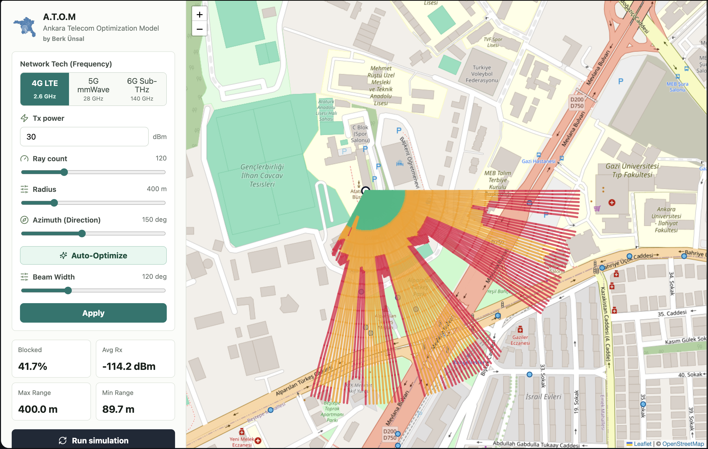
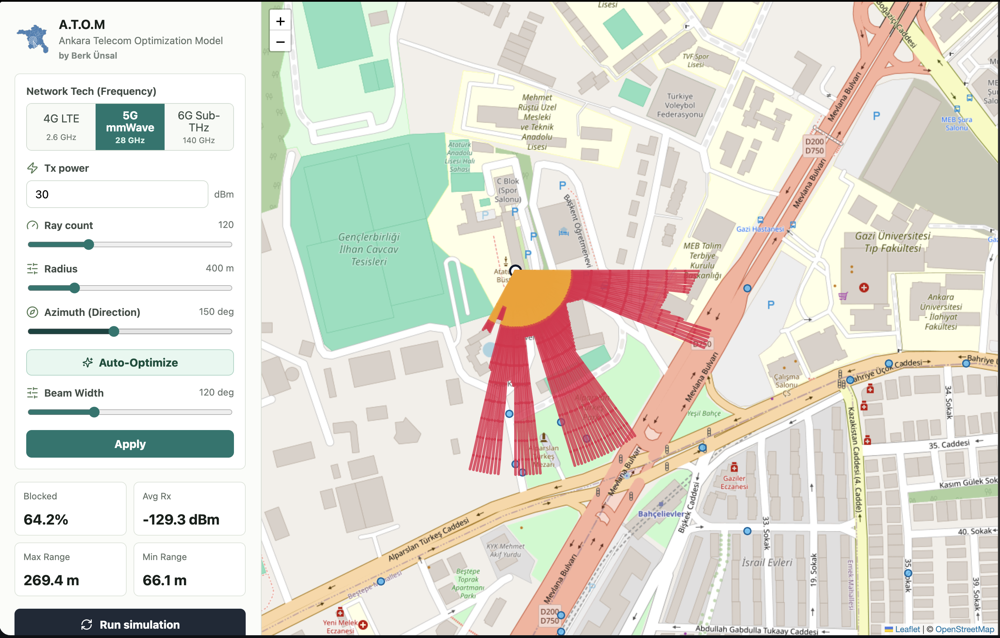
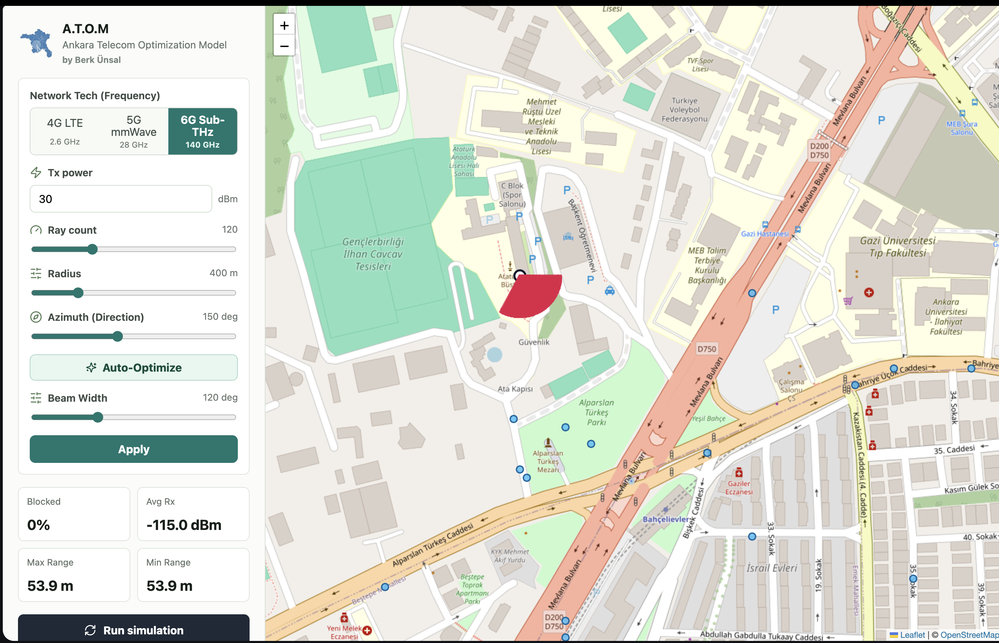
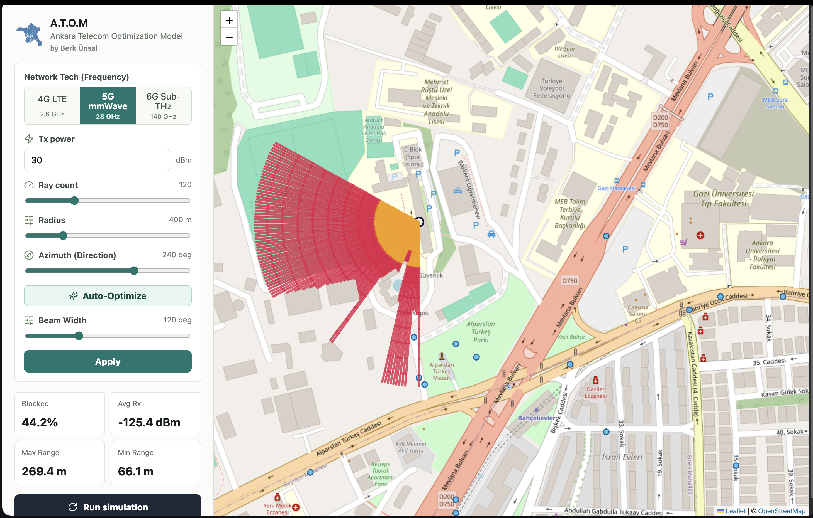

# Propagation Visualization

A.T.O.M visualizes deterministic RF planning estimates across frequency bands using Ankara's urban topology. The images are model outputs, not measured coverage maps.

## Stored band illustrations

The images below illustrate band-dependent model outputs. Their complete request/model lineage is not embedded in the images, so they are not current benchmark or validation evidence. For a reproducible comparison, inspect a named Run and its model, inputs, dataset and current map legend.

### 4G LTE at 2.6 GHz

The normal 2.6 GHz preset uses the deterministic urban UMa LOS/NLOS subset. A lower frequency can change estimated path loss under the configured assumptions; a colored outdoor ray does not establish indoor service or an application throughput level.

### 5G mmWave at 28 GHz

The normal 28 GHz preset uses the same declared model family with its frequency and antenna inputs. Urban empirical NLOS does not receive an extra legacy wall-event penalty. Inspect the applied model and any explicit legacy fallback before comparing results.

### 140 GHz research profile

The 140 GHz profile is research/reference only and retains a conservative attenuation heuristic. It is not a standardized or field-validated 6G service model. Ordinary radio-quality and measurement-validation workflows are unavailable for it.

---

## Auto-Optimized 5G Sector

### Algorithm Result

This illustration shows a recommended direction from the single-sector discrete sweep, not proof of a global optimum:

- **Demand-aware score**: POI demand, residential-density demand, and capped coverage tie-breakers guide azimuth selection
- **Beam Width**: 65° (typical 3-sector configuration)
- **Runtime**: depends on the request, geometry and machine; this image is not a timing benchmark

### Interpretation

The auto-optimized placement achieves:

- ✅ Stronger demand-serving direction within distance constraints
- Stronger modeled coverage toward demand-weighted locations
- A reproducible azimuth recommendation from the configured sweep

**Key Insight**: The optimizer consistently compares candidate azimuths using the same demand and coverage score. It does not predict live-network spectral efficiency.

---

## Color Mapping Reference

The map uses a display-only received-power palette. It is not a universal service-quality legend: receiver sensitivity is per effective cell, building service uses a separate `-100 dBm` threshold, and interference serviceability uses RSRP/SINR/RSRQ thresholds.

Read the live legend for the selected metric and Run. Stronger received power is not a guarantee of indoor, emergency, voice or data service. RSRP/SINR/RSRQ serviceability, receiver sensitivity, building service and display floors use different declared rules.

## Comparing bands and plans

Keep selected Cells, input assumptions, dataset and result lineage visible. Compare baseline/recommendation metrics and sample locations under those conditions. Do not infer a universal coverage radius or required site density from a band label or these stored pictures; no such deployment-sizing result has been validated here.

---

## Understanding the Heatmaps

### Ray Segments

Each heatmap consists of thousands of **ray segments** (colored lines):

- **Start Point**: Transmitter antenna
- **End Point**: Modeled sample position along the configured path
- **Color**: Represents signal strength at that distance/direction
- **Direction**: Shows propagation pattern and antenna beam orientation

### Reading the Visualization

1. **Green segments**: Stronger modeled received power according to the current legend
2. **Yellow segments**: Intermediate modeled power; inspect the relevant receiver and service thresholds
3. **Red segments**: Weaker modeled power; inspect the sample and applied model before interpreting service
4. **No Color**: Below the visual display floor or outside the rendered evidence; this does not mean the API value is NoData or that it fails every serviceability rule

### Analytical Surface Layer

The Signal surface tool replaces dense point markers with a regular raw single-cell received-power raster drawn below operational markers. Adjust opacity to compare it with the basemap and select a display floor to hide weaker cells; that floor is visual only. Valid below-sensitivity values remain in the surface, while NoData means radius/beam geometry exclusion. Contours are unsmoothed marching-square line segments at the selected dBm thresholds; they are deterministic grid evidence, not kriged measurement isolines. The surface is calculated for one selected cell, so it is not an aggregate network-coverage claim.

### RF Map Display Controls

The compact RF control group keeps the two evidence types independent:

- **Signal** toggles the received-power surface when one has been generated.
- **Rays** toggles the segmented propagation paths without issuing another RF request.
- **All cells**, **Selected cell**, and **Hidden** control which network ray paths are rendered. The Selected cell choice uses the separate **Focus** cell selector; it does not change the Pareto solution selected in Results.

Until a surface is generated, rays are the visible RF fallback. Generating a received-power surface switches the map to a surface-first view and hides rays; rays can be enabled again for diagnostic inspection. Presentation-only changes are local browser state. RF settings, cell selection, or a new optimization/evaluation clear incompatible rendered evidence and require the normal explicit analysis action.

The raster uses the resolved canonical propagation and antenna profile: the urban subset at 2.6/28 GHz, or the explicitly selected/reported legacy or research behavior. It does not inherit optional terrain, gas, rain, vegetation, or diffraction settings from a point-to-point profile.

Enable **Viewport buildings** in Layers at zoom 12 or closer to request only the visible building footprints. Fill hue reflects normalized material when known and opacity increases modestly with inferred height; it is contextual geometry, not a surveyed 3D mesh.

### Vertical Path Profile

The Propagation tool's path view shows ground, building tops, endpoint elevations, the direct LOS line, 60% Fresnel clearance, and any dominant obstruction. The adjacent component table is the authoritative explanation of which optional losses were enabled. A red obstruction does not imply a complete multiple-edge diffraction or reflected-path solution.

### Interactive Exploration

In the web interface, you can:

- 🔄 Adjust antenna azimuth and watch coverage rotate
- 📊 Switch between frequency bands and compare
- 🧭 Focus a selected network cell while keeping the planning selection unchanged
- 🗺️ Switch between the received-power surface and diagnostic ray evidence
- Inspect configured analytic antenna directions and patterns; array/codebook beamforming is not implemented
- 📍 Inspect sampled modeled received power (Rx dBm) and its source Run

---

## Validation Boundary

Measured real-world propagation accuracy is not yet established. A.T.O.M has not been calibrated against operator drive tests or UE measurements. Treat Rx, RSRP, SINR, and RSRQ values as planning estimates for scenario comparison, then validate deployment decisions with calibrated tools and field measurements.

---

## Export and Integration

Analytical surfaces can be exported as float32 EPSG:4326 GeoTIFF, contour GeoJSON, or grid-center CSV. Viewport building queries return GeoJSON or CSV/WKT. These can be used in:

- 🗺️ **ArcGIS**: Professional GIS analysis
- 🌍 **Google Earth**: 3D visualization
- 📋 **QGIS**: Open-source mapping
- 🔗 **Custom applications**: Any GeoJSON-compatible tool

---

**Next**: Learn the physics behind these visualizations in [Algorithms & Physics](algorithms.md).

## Application appearance

Use Layers → Appearance to select Light, Dark, or System. The preference is local to the browser. Dark uses a native Alidade Smooth Dark basemap and semantic shell colors; RF categories, thresholds, geometry, results and exported identity stay fixed. Active, selected, inspected and focused cells retain separate ring/order semantics. OpenStreetMap and Alidade Smooth remain selectable. See [appearance details](dark-mode.md) and the [matched comparison report](dark-mode-visual-comparison.md).
