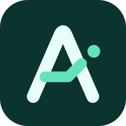

# ATOM icon assets

[Editable Figma source](https://www.figma.com/design/5N62W8fSHMNj5fLLA1Zjj3?node-id=4-2) · [Primary SVG](icon.svg) · [Design proof](preview.png)



The **Signal A** combines an antenna-shaped A, a bent ray path and a detached
signal node. It inherits ATOM's teal palette and uses a bold silhouette instead
of geographic detail that disappears at small sizes.

## Tools researched and used

| Tool | Role and availability | Decision |
| --- | --- | --- |
| [Figma Design](https://help.figma.com/hc/en-us/articles/13402894554519-Export-formats-and-settings-for-static-designs) | Connected vector authoring, editable paths, SVG export and visual inspection | Used for the master artwork, variants and design proof |
| [Penpot](https://penpot.app/features) | SVG-based vector editing and boolean operations; no connected Penpot tool in this session | Suitable open-source alternative; these SVGs remain portable |
| [Inkscape](https://inkscape.org/) | Dedicated SVG editor; not installed locally | Suitable desktop alternative for future editing |
| [SVGO](https://svgo.dev/docs/usage/) | SVG optimization through Node.js | Used at pinned version 4.0.0; configuration is committed |
| [librsvg](https://github.com/GNOME/librsvg/blob/main/rsvg-convert.rst) | Local `rsvg-convert` raster renderer | Used to render every PNG directly from SVG at its target size |
| Apple `iconutil` | Local macOS iconset packager | Used to create the multi-resolution ICNS |

Figma exports are actual vector geometry, with no embedded bitmaps, external
resources or font dependencies. SVG-native strokes scale with the viewBox.
The file sizes are kept small with SVGO; PNGs are compatibility exports, not
the master artwork.

## Pick the right file

| Use | Asset |
| --- | --- |
| README, app header, website branding | [`icon.svg`](icon.svg): rounded dark teal tile, pale A and mint ray |
| Browser favicon, especially 16–24 px | [`favicon.svg`](favicon.svg): larger symbol and signal node for small sizes |
| Transparent mark on a light surface | [`atom-mark.svg`](atom-mark.svg): ATOM teal |
| Transparent mark on a dark surface | [`atom-mark-white.svg`](atom-mark-white.svg): solid white |
| A single ink or CSS-controlled color | [`atom-mark-mono.svg`](atom-mark-mono.svg): `currentColor` |
| An OS or platform that applies its own corner mask | [`atom-square.svg`](atom-square.svg): square, opaque artwork |
| macOS packaging | [`atom.icns`](atom.icns): 16–1024 px representations; [`atom-macos.svg`](atom-macos.svg) is its padded vector source |
| Windows packaging | [`atom.ico`](atom.ico): embedded 16, 24, 32, 48, 64, 128 and 256 px PNGs |
| Linux launchers and other raster consumers | [`png/atom-512.png`](png/atom-512.png), with other sizes in [`png/`](png/) |
| Apple touch icon | [`png/apple-touch-icon.png`](png/apple-touch-icon.png): opaque 180 px square |

`png/atom-{size}.png` is available at 16, 20, 24, 32, 48, 64, 128, 192, 256,
512 and 1024 px. The 16–24 px exports use the favicon geometry. The ICNS has
its own transparent canvas padding: the tile occupies 824 px of the 1024 px
canvas. Keep that padding when packaging a macOS app. The square source and
Apple touch icon deliberately let the consuming OS apply its corner mask.

The `.icns` is a conventional static desktop asset. A future native app using
Apple's layered Icon Composer format can reuse the SVG paths as its source.

## Usage

The README, React header and documentation header already reference
`icon/icon.svg` or their local copy of it. Their URLs continue to work.

```html

<link rel="icon" type="image/x-icon" href="/icon/favicon.ico" />
<link rel="icon" type="image/svg+xml" href="/icon/favicon.svg" sizes="any" />
<link rel="apple-touch-icon" sizes="180x180" href="/icon/apple-touch-icon.png" />
```

For an image next to visible ATOM text, use `alt=""` to avoid repeating the
name. Inline the monochrome SVG to inherit CSS `color`; an SVG loaded through
`` cannot inherit the surrounding page's `currentColor`.

Use the supplied favicon at 16–24 px. Use the transparent mark at 24 px or
larger. Preserve its aspect ratio and canvas margins; add clear space of at
least one eighth of the visible mark's width next to other graphics. Keep the
node attached to the identity, preserve the ray angle, and avoid extra outlines,
shadows or text inside the icon.

| Color | Value | Role |
| --- | --- | --- |
| Deep teal | `#0B342F` | App tile |
| Pale mint | `#E8FFF7` | A on the tile |
| Signal mint | `#63E3BC` | Ray and node on the tile |
| ATOM teal | `#0F766E` | Standalone mark on light surfaces |

## Rebuild and verify

Install librsvg (`brew install librsvg` on macOS or your platform's librsvg
package). Export changed masters from the linked Figma file as SVG, keeping
the matching filenames. Optimize the seven production SVG files:

```sh
npx --yes --package=svgo@4.0.0 svgo --config icon/svgo.config.mjs --folder icon
python3 scripts/build-icons.py
python3 scripts/build-icons.py --check
```

Run from the repository root. The build script renders the PNGs, writes the
multi-image ICO, packages the ICNS with `iconutil` on macOS, then synchronizes
the four web assets into `frontend-react/public/icon/` and `docs/icon/`.
On other systems, the committed ICNS is preserved and must be rebuilt on a
Mac after changing the source artwork. Preserve `role="img"` and
`aria-label="ATOM"` on replacement SVG roots. For the monochrome variant,
replace the exported ink with `currentColor`.

`--check` requires only Python's standard library. It checks self-contained
vector markup, square viewBoxes, accessible names, all PNG dimensions, every
ICO entry and its exact PNG payload, ICNS structure and the 1024 px layer, and
byte-identical web copies. `preview.png` is the visual proof exported from
the Figma file; update it there when the artwork changes.

These assets follow the repository's [MIT license](../LICENSE).
